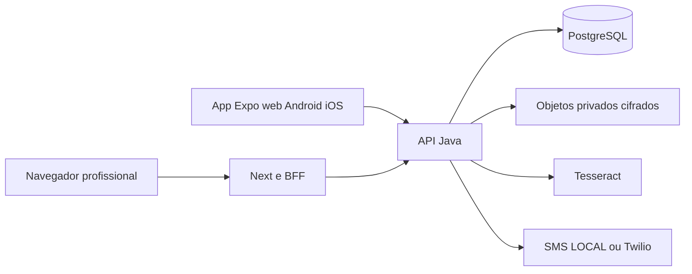

# Viva+ / Pulso em Dia

**Revisão atual do PR #1 (29/10/2026):** Boot 4.1.2/Java 21 e dependências corrigidas; 81 Java, 88 frontend e 17 E2E aprovados, auditoria Java completa sem alertas e pnpm sem altos/críticos. Novo CI remoto ainda pendente. [Relatório da revisão](docs/evidencias/CORRECAO_DEPENDENCIAS_PR1_2026-10-29.md). Os estados anteriores abaixo são históricos.

Demonstração acadêmica de acompanhamento de pacientes: aplicativo React Native/Expo, portal profissional Next.js e API Java21/Spring Boot/PostgreSQL. Cadastro, ativação por aparelho, pressão, medicamentos/autorrelatos, refeições, atividades, diário e consultas usam APIs e persistência reais. Utilizar exclusivamente pessoas, registros e imagens sintéticos.

**Estado:** funcional no escopo local documentado, em desenvolvimento. Migrações V1–V9 aplicadas; SMS LOCAL testado, Twilio preparado sem envio externo; OCR Tesseract real com conferência obrigatória. Há 40 pendências, incluindo dois alertas altos de dependências, testes físicos Android/iOS, decisões institucionais, integrações e implantação. Export Hermes não é APK/IPA. APP_ENV=production é bloqueado. Publicação deste fonte não libera uso clínico ou deployment.

## Comece por aqui

1. [Manual técnico completo](docs/MANUAL_TECNICO_COMPLETO_VIVAMAIS.md): produto, versões, arquitetura, pastas e segurança.
2. [Ambiente do zero no Windows11](docs/GUIA_COMPLETO_AMBIENTE_DESENVOLVIMENTO.md): clone, credenciais próprias, banco, bootstrap e execução.
3. [Inventário funcional](docs/INVENTARIO_COMPLETO_FUNCIONALIDADES.md) e [como os módulos foram implementados](docs/COMO_FORAM_IMPLEMENTADAS_AS_FUNCIONALIDADES.md).
4. [Manual de testes](docs/MANUAL_COMPLETO_TESTES_DESENVOLVEDOR.md), [banco/migrações](docs/ARQUITETURA_BANCO_DADOS.md) e [catálogo API/rotas](docs/CATALOGO_API_E_ROTAS.md).
5. [Pendências por ID](docs/LEVANTAMENTO_COMPLETO_PENDENCIAS.md), [plano de continuidade](docs/PLANO_TECNICO_CONTINUIDADE_DESENVOLVIMENTO.md) e [padrões](docs/PADROES_DESENVOLVIMENTO_VIVAMAIS.md).

[Índice de toda a documentação](docs/INDICE_DOCUMENTACAO.md) · [Relatório de consolidação/publicação](docs/RELATORIO_TRANSFERENCIA_E_PUBLICACAO.md) · [Contribuir](CONTRIBUTING.md)

## Tecnologias e arquitetura

Node24 (engines >=22.16 e <25), pnpm10.28.2, React19.2.3, React Native0.86.3, Expo57.0.21, Next16.4.2, TypeScript5.9.3; Java21, Spring Boot4.1.2, Maven Wrapper3.9.11, JDBC e PostgreSQL17/Flyway. Versões exatas nos manifests/lockfile/POM. Não usar npm install dentro de web ou pnpm11 para regravar o lock.



A API é a autoridade de autorização/negócio. Paciente usa CPF+nascimento para identificar e código/aparelho para autenticar; profissional usa senha. Sessões são opacas/revogáveis. Não há token em localStorage ou acesso direto dos clientes ao banco/storage. JDBC é a persistência atual, sem JPA.

## Instalar e iniciar

```powershell
git clone https://github.com/joaosoares03/vivamais.git
Set-Location .\vivamais
npm.cmd exec --yes --package=pnpm@10.28.2 -- pnpm install --frozen-lockfile
```

Clone novo exige JDK21, PostgreSQL17 e credenciais próprias. Siga o [guia do zero](docs/GUIA_COMPLETO_AMBIENTE_DESENVOLVIMENTO.md) para criar banco/role, configurar `.local/configuracao-local.json` sem senhas, usar entrada protegida e fazer bootstrap **somente em banco sintético novo**. Nenhuma senha padrão ou arquivo privado do autor é distribuído. Maven não lê .env automaticamente.

Depois de configurar banco e bootstrap:

```powershell
.\Iniciar-VivaMais.cmd -Producao -SmsLocal -Recompilar
```

O atalho seleciona PowerShell7 e inicia API8080, portal3000 e app8081. `-Producao` significa build otimizado local, APP_ENV=development; `-SmsLocal` habilita caixa de teste sem operadora. Nas próximas execuções pode omitir -Recompilar. Para desenvolvimento usar o atalho sem -Producao ou os comandos separados do guia. Não iniciar dois conjuntos nas mesmas portas.

| Uso local | Endereço |
| --- | --- |
| Portal profissional | http://127.0.0.1:3000/ |
| Aplicativo do paciente | http://127.0.0.1:8081/acesso |
| Saúde básica da API | http://127.0.0.1:8080/actuator/health |

Na máquina original: PostgreSQL17.9 portátil, porta55432, banco vivamais, usuário viva. A instalação18/5432 é outra instância; não misturar. Compose opcional usa17.9/5432/usuário vivamais e volumes próprios; Docker não foi ensaiado nesta máquina.

Profissional sintético: `profissional.a@demo.vivamais.invalid` ou admin equivalente, com a senha **escolhida por você** no bootstrap. Há unidade B para isolamento. Paciente novo é cadastrado no portal com celular/CPF/nascimento fictícios, recebe ativação assistida e entra pelo aplicativo. Em LOCAL, o operador consulta o código privado usando a referência UUID; [passo a passo SMS](docs/CADASTRO_E_ATIVACAO_SMS.md). Código não aparece no portal/API comum. CPF matematicamente válido não é consulta oficial ou prova de identidade.

Encerrar por Enter no controlador ou `infra/encerrar-local.ps1`; preservar banco, objetos, chaves e volumes. Para a máquina já configurada, [guia Windows existente](docs/GUIA_COMPLETO_EXECUCAO_LOCAL_WINDOWS.md). Para percorrer telas, [Como navegar](docs/COMO_NAVEGAR.md).

## Testar

Usar pnpm10.28.2. Java exige Java21 e PostgreSQL/Testcontainers; E2E exige API provisionada, SMS LOCAL, export atual e E2E_PASSWORD privada. [Manual com comandos completos e diagnóstico](docs/MANUAL_COMPLETO_TESTES_DESENVOLVEDOR.md).

```powershell
pnpm typecheck
pnpm lint
pnpm test
pnpm build:web
pnpm export:mobile
pnpm contracts:generate
.\backend\demo\mvnw.cmd -f backend/demo/pom.xml verify
pnpm test:e2e
pnpm audit --audit-level high
```

Entrega local anterior à consolidação: 74 Java, 69 frontend, 17 E2E. Resultados repetidos nesta tarefa, builds/scanners e estado do CI estão no [relatório atual](docs/RELATORIO_TRANSFERENCIA_E_PUBLICACAO.md). A auditoria mantém dois altos: não esconder exit1 nem confundir testes funcionais com produção liberada. Não houve teste físico, operadora real ou consulta oficial de CPF.

## Estrutura e continuidade

| Caminho | Responsabilidade |
| --- | --- |
| app/,components/,contexts/,hooks/,services/,assets/ | Aplicativo Expo na raiz |
| web/app/,web/components/,web/hooks/,web/services/ | Portal Next e BFF |
| backend/demo/ | Java em camadas, Wrapper, testes, OpenAPI e migraçõesV1–V9 |
| packages/ | Contratos/validações e tokens compartilhados |
| infra/,tests/,.github/ | Execução, OCR, backup, capturas, regressões e CI |
| docs/,referencias_codex/ | Especificação, protótipos, evidências e transferência |

Não recriar apps/mobile,apps/web,services/api ou Git aninhado. Migrations aplicadas são imutáveis; coordenar próxima versão. .local,node_modules,target,dist,backups e work privado ficam fora do Git. O histórico anterior inclui99c7295 e b460643; conferir git log, sem depender de cópia antiga de relatório.

Exercícios e IA têm responsáveis específicos: [exercícios](docs/TRANSFERENCIA_DEV_EXERCICIOS.md), [IA/OCR](docs/TRANSFERENCIA_DEV_INTELIGENCIA_ARTIFICIAL.md), [matriz](docs/MATRIZ_RESPONSABILIDADES_DESENVOLVIMENTO.md). Não implementar prescrições/modelos sem critérios aprovados. Dev geral mantém funções transversais; escolher tarefaPxx pelo plano e seguir [CONTRIBUTING](CONTRIBUTING.md).

Preservada a [infraestrutura econômica](docs/operations/HOSPEDAGEM_DEMO.md): Vercel, Railway, Supabase e EAS. Preços têm referência datada e precisam de reconfirmação antes de contratar. Nenhum deployment, loja, conta paga ou alteração de visibilidade faz parte desta publicação de código-fonte.
