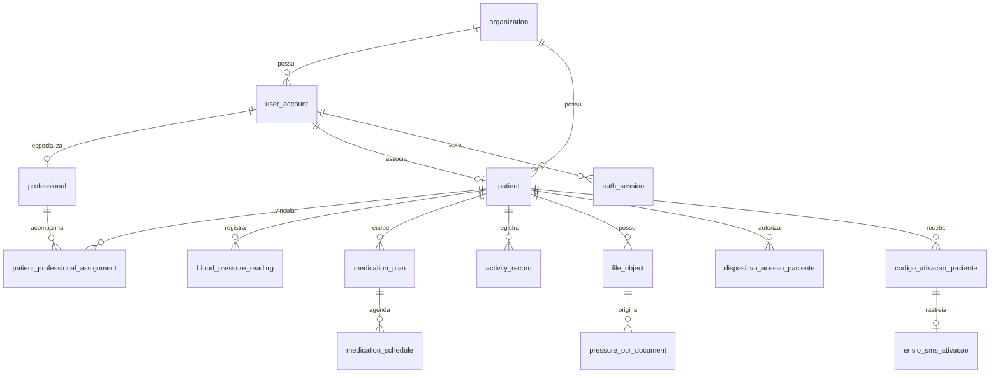

# Arquitetura do banco de dados

Metadados consultados em20/10/2026, somente leitura: PostgreSQL17.9,127.0.0.1:55432,banco vivamais,owner de aplicação viva,schema public. Testes novos usam outro banco exclusivo; schemas UUID por classe. Nenhuma linha clínica é reproduzida neste documento. Não confundir instalação18/5432 nem credenciais Compose (vivamais/5432).

## Modelo e fronteiras



São33 tabelas,32comRLS e0políticas de leitura direta. V5–V9 revogam acesso direto de PUBLIC/anon/authenticated quando existentes; a role JDBC é proprietária e não há FORCE RLS/tenant context que dispense escopo Java. Toda operação deve checar organização/vínculo/titular, com testes de negação. As FKs compostas reforçam relação por unidade nas tabelas institucionais; tabelas de cuidado usam paciente e autor conforme constraints abaixo. Não dar credencial de proprietário ao frontend.

### Privilégios locais encontrados

Metadados de pg_roles confirmaram superusuário=true, BYPASSRLS=true, criação de roles/bancos=true na credencial da demonstração atual. Não há senha neste documento; não se alterou a role/banco para a auditoria. Esse perfil é inadequado ao runtime hospedado. Em P01/G01 separar conexão de migração/DDL e execução com privilégios mínimos; opções incluem credencial Flyway separada ou etapa de migração controlada. A decisão produtiva permanece pendente, e o ensaio deve conferir rolsuper/rolbypassrls=false no runtime, direitos de tabelas/sequências estritamente necessários e regressão das58 operações. Não retirar ownership/privilégios do banco existente sem plano/revisão/backup.

## Migrações aplicadas

V1–V9 são imutáveis. O checksum Flyway é conferido ao iniciar a API. Não confundir checksumCRC do Flyway com SHA256 de proveniência das fontes.

| Versão | Arquivo | O que implementou | Estado | SHA256 fonte |
| --- | --- | --- | --- | --- |
| V1 | [V1__foundation.sql](../backend/demo/src/main/resources/db/migration/V1__foundation.sql) | Fundação: unidade,contas,papéis,pacientes,vínculos,sessão,base legal e trilha imutável | Aplicada com sucesso | `b89edd886ccd718e6493ada25a31b49050b273aa21ff53d5ed0825f9f807d7b2` |
| V2 | [V2__care.sql](../backend/demo/src/main/resources/db/migration/V2__care.sql) | Módulos de cuidado: convite legado,idempotência,pressão,medicamentos/horários/histórico/autorrelato,perfil/atividade,diário,consulta,dispositivo/configuração | Aplicada com sucesso | `ba1a28b0c1e4553ee81c5b11b31903d8fd1e24cf2ea8cf47d9d808bbded3f3b9` |
| V3 | [V3__private_files.sql](../backend/demo/src/main/resources/db/migration/V3__private_files.sql) | Arquivos privados/grants,documento OCR e refeição,proteções associadas | Aplicada com sucesso | `57cdd46883c9aeacdb277cf9c3fe4c67a318983ff948a7a552d9b815c4b85e46` |
| V4 | [V4__analysis_budget.sql](../backend/demo/src/main/resources/db/migration/V4__analysis_budget.sql) | Tentativas/orçamento da análise alimentar | Aplicada com sucesso | `cd7177b276a375a8c5c1d29c5ce4117c951f820c2e27c0f559f63b6ad4a5d8e2` |
| V5 | [V5__bloquear_acesso_direto_cliente.sql](../backend/demo/src/main/resources/db/migration/V5__bloquear_acesso_direto_cliente.sql) | RLS/revogação de acesso direto nas tabelas de domínio; exclui tabela do Flyway | Aplicada com sucesso | `7815fdae3195aad449ad9218ede1fbbf68612cb516c996ec7be22b040c8a9672` |
| V6 | [V6__dados_pessoais_paciente.sql](../backend/demo/src/main/resources/db/migration/V6__dados_pessoais_paciente.sql) | Dados pessoais,CPF/nascimento/telefone/endereço/contato e versão;unicidade de CPF por unidade | Aplicada com sucesso | `c50d6a7d7896a9dfea12616faf6648f70fa9aa2da3132b1a0432bd918e2ee350` |
| V7 | [V7__preferencias_conta.sql](../backend/demo/src/main/resources/db/migration/V7__preferencias_conta.sql) | Preferências por conta e concorrência | Aplicada com sucesso | `61eeb470ae076e4babb249ae14f9ae00f439e0f4b6a0a415f402dd18b40a55d2` |
| V8 | [V8__acesso_paciente_sem_senha.sql](../backend/demo/src/main/resources/db/migration/V8__acesso_paciente_sem_senha.sql) | Acesso paciente sem senha: aparelho,código,desafio,limites e vinculação de sessão; preserva dados | Aplicada com sucesso | `0d8c4b991e42aed7072697e74738154d949ee7f650d015fb56715d104bdc6daa` |
| V9 | [V9__envio_sms_ativacao.sql](../backend/demo/src/main/resources/db/migration/V9__envio_sms_ativacao.sql) | Telefone varchar16/versão/confirmação,envio SMS protegido; invalida códigos manuais antigos, preserva aparelhos/registros | Aplicada com sucesso | `20fa8475c5eab96f53668ef61e1a628c41c12d5ce9c6b60b4b7a88c125ab83f4` |

## Dicionário completo

Definições extraídas de information_schema e pg_catalog,sem valores de usuários. `p`=primary key,`f`=foreign key,`u`=unique,`c`=check. Índices incluem os implícitos dePK/unique. RLS é estado técnico, não certificação de segurança.

### `account_activation`

Legado do convite de acesso anterior, não canal atual de código. RLS: habilitada.

| Coluna | Tipo PostgreSQL | Aceita nulo | Default |
| --- | --- | --- | --- |
| `id` | uuid | NO | Sem default |
| `user_account_id` | uuid | NO | Sem default |
| `token_hash` | character(64) (bpchar) | NO | Sem default |
| `expires_at` | timestamp with time zone (timestamptz) | NO | Sem default |
| `used_at` | timestamp with time zone (timestamptz) | YES | Sem default |
| `created_at` | timestamp with time zone (timestamptz) | NO | now() |

Restrições:

- `account_activation_token_hash_key` (u): `UNIQUE (token_hash)`
- `account_activation_pkey` (p): `PRIMARY KEY (id)`
- `account_activation_user_account_id_fkey` (f): `FOREIGN KEY (user_account_id) REFERENCES user_account(id)`

Índices:

- `CREATE UNIQUE INDEX account_activation_pkey ON public.account_activation USING btree (id)`
- `CREATE UNIQUE INDEX account_activation_token_hash_key ON public.account_activation USING btree (token_hash)`

### `activity_record`

Atividade voluntária registrada e estado informado. RLS: habilitada.

| Coluna | Tipo PostgreSQL | Aceita nulo | Default |
| --- | --- | --- | --- |
| `id` | uuid | NO | Sem default |
| `patient_id` | uuid | NO | Sem default |
| `author_id` | uuid | NO | Sem default |
| `type` | character varying(160) (varchar) | NO | Sem default |
| `duration_minutes` | integer (int4) | NO | Sem default |
| `occurred_at` | timestamp with time zone (timestamptz) | NO | Sem default |
| `notes` | character varying(2000) (varchar) | NO | ''::character varying |
| `feeling` | character varying(20) (varchar) | NO | Sem default |
| `created_at` | timestamp with time zone (timestamptz) | NO | now() |
| `synced_at` | timestamp with time zone (timestamptz) | NO | now() |

Restrições:

- `activity_record_duration_minutes_check` (c): `CHECK (((duration_minutes >= 1) AND (duration_minutes <= 1440)))`
- `activity_record_feeling_check` (c): `CHECK (((feeling)::text = ANY ((ARRAY['WELL'::character varying, 'TIRED'::character varying, 'UNWELL'::character varying])::text[])))`
- `activity_record_pkey` (p): `PRIMARY KEY (id)`
- `activity_record_patient_id_fkey` (f): `FOREIGN KEY (patient_id) REFERENCES patient(id)`
- `activity_record_author_id_fkey` (f): `FOREIGN KEY (author_id) REFERENCES user_account(id)`

Índices:

- `CREATE INDEX activity_patient_time ON public.activity_record USING btree (patient_id, occurred_at DESC, id)`
- `CREATE UNIQUE INDEX activity_record_pkey ON public.activity_record USING btree (id)`

### `audit_event`

Trilha de ator/ação/recurso; triggers recusam UPDATE/DELETE/TRUNCATE. RLS: habilitada.

| Coluna | Tipo PostgreSQL | Aceita nulo | Default |
| --- | --- | --- | --- |
| `id` | uuid | NO | Sem default |
| `organization_id` | uuid | NO | Sem default |
| `actor_id` | uuid | NO | Sem default |
| `action` | character varying(80) (varchar) | NO | Sem default |
| `resource_type` | character varying(80) (varchar) | NO | Sem default |
| `resource_id` | uuid | YES | Sem default |
| `occurred_at` | timestamp with time zone (timestamptz) | NO | now() |

Restrições:

- `audit_event_pkey` (p): `PRIMARY KEY (id)`
- `audit_event_organization_id_fkey` (f): `FOREIGN KEY (organization_id) REFERENCES organization(id)`
- `audit_event_actor_id_organization_id_fkey` (f): `FOREIGN KEY (actor_id, organization_id) REFERENCES user_account(id, organization_id)`

Índices:

- `CREATE UNIQUE INDEX audit_event_pkey ON public.audit_event USING btree (id)`
- `CREATE INDEX audit_organization_time_idx ON public.audit_event USING btree (organization_id, occurred_at)`

### `auth_session`

Hash de token opaco, expiração e revogação. RLS: habilitada.

| Coluna | Tipo PostgreSQL | Aceita nulo | Default |
| --- | --- | --- | --- |
| `id` | uuid | NO | Sem default |
| `user_account_id` | uuid | NO | Sem default |
| `token_hash` | character(64) (bpchar) | NO | Sem default |
| `created_at` | timestamp with time zone (timestamptz) | NO | Sem default |
| `expires_at` | timestamp with time zone (timestamptz) | NO | Sem default |
| `revoked_at` | timestamp with time zone (timestamptz) | YES | Sem default |
| `id_dispositivo_paciente` | uuid | YES | Sem default |

Restrições:

- `auth_session_check` (c): `CHECK ((expires_at > created_at))`
- `auth_session_pkey` (p): `PRIMARY KEY (id)`
- `auth_session_token_hash_key` (u): `UNIQUE (token_hash)`
- `auth_session_user_account_id_fkey` (f): `FOREIGN KEY (user_account_id) REFERENCES user_account(id)`
- `auth_session_id_dispositivo_paciente_fkey` (f): `FOREIGN KEY (id_dispositivo_paciente) REFERENCES dispositivo_acesso_paciente(id)`

Índices:

- `CREATE UNIQUE INDEX auth_session_pkey ON public.auth_session USING btree (id)`
- `CREATE UNIQUE INDEX auth_session_token_hash_key ON public.auth_session USING btree (token_hash)`
- `CREATE INDEX session_expiry_idx ON public.auth_session USING btree (expires_at)`

### `blood_pressure_reading`

Medição conferida, origem/autoria/ocorrência. RLS: habilitada.

| Coluna | Tipo PostgreSQL | Aceita nulo | Default |
| --- | --- | --- | --- |
| `id` | uuid | NO | Sem default |
| `patient_id` | uuid | NO | Sem default |
| `author_id` | uuid | NO | Sem default |
| `systolic` | integer (int4) | NO | Sem default |
| `diastolic` | integer (int4) | NO | Sem default |
| `pulse` | integer (int4) | YES | Sem default |
| `measured_at` | timestamp with time zone (timestamptz) | NO | Sem default |
| `source` | character varying(30) (varchar) | NO | Sem default |
| `ocr_document_id` | uuid | YES | Sem default |
| `created_at` | timestamp with time zone (timestamptz) | NO | now() |
| `synced_at` | timestamp with time zone (timestamptz) | NO | now() |

Restrições:

- `blood_pressure_reading_systolic_check` (c): `CHECK (((systolic >= 1) AND (systolic <= 400)))`
- `blood_pressure_reading_diastolic_check` (c): `CHECK (((diastolic >= 1) AND (diastolic <= 400)))`
- `blood_pressure_reading_pulse_check` (c): `CHECK (((pulse >= 1) AND (pulse <= 300)))`
- `blood_pressure_reading_source_check` (c): `CHECK (((source)::text = ANY ((ARRAY['MANUAL'::character varying, 'PROFESSIONAL'::character varying, 'PRINTED_DIARY'::character varying, 'OCR_CONFIRMED'::character varying])::text[])))`
- `blood_pressure_reading_pkey` (p): `PRIMARY KEY (id)`
- `blood_pressure_reading_patient_id_fkey` (f): `FOREIGN KEY (patient_id) REFERENCES patient(id)`
- `blood_pressure_reading_author_id_fkey` (f): `FOREIGN KEY (author_id) REFERENCES user_account(id)`
- `reading_ocr_document_fk` (f): `FOREIGN KEY (ocr_document_id) REFERENCES pressure_ocr_document(id)`

Índices:

- `CREATE UNIQUE INDEX blood_pressure_reading_pkey ON public.blood_pressure_reading USING btree (id)`
- `CREATE INDEX reading_patient_time ON public.blood_pressure_reading USING btree (patient_id, measured_at DESC, id)`

### `codigo_ativacao_paciente`

HMAC,contexto,uso único e validade do código. RLS: habilitada.

| Coluna | Tipo PostgreSQL | Aceita nulo | Default |
| --- | --- | --- | --- |
| `id` | uuid | NO | Sem default |
| `id_paciente` | uuid | NO | Sem default |
| `hash_codigo` | character(64) (bpchar) | NO | Sem default |
| `criado_em` | timestamp with time zone (timestamptz) | NO | now() |
| `expira_em` | timestamp with time zone (timestamptz) | NO | Sem default |
| `utilizado_em` | timestamp with time zone (timestamptz) | YES | Sem default |
| `id_emissor` | uuid | NO | Sem default |

Restrições:

- `codigo_ativacao_paciente_pkey` (p): `PRIMARY KEY (id)`
- `codigo_ativacao_paciente_id_paciente_fkey` (f): `FOREIGN KEY (id_paciente) REFERENCES patient(id)`
- `codigo_ativacao_paciente_id_emissor_fkey` (f): `FOREIGN KEY (id_emissor) REFERENCES user_account(id)`

Índices:

- `CREATE UNIQUE INDEX codigo_ativacao_paciente_pkey ON public.codigo_ativacao_paciente USING btree (id)`
- `CREATE INDEX codigo_por_paciente ON public.codigo_ativacao_paciente USING btree (id_paciente, criado_em DESC)`

### `consent_or_legal_basis_record`

Registro de finalidade/base legal; fluxo institucional ainda pendente. RLS: habilitada.

| Coluna | Tipo PostgreSQL | Aceita nulo | Default |
| --- | --- | --- | --- |
| `id` | uuid | NO | Sem default |
| `patient_id` | uuid | NO | Sem default |
| `organization_id` | uuid | NO | Sem default |
| `purpose` | character varying(300) (varchar) | NO | Sem default |
| `basis_reference` | character varying(300) (varchar) | NO | Sem default |
| `recorded_by` | uuid | NO | Sem default |
| `recorded_at` | timestamp with time zone (timestamptz) | NO | now() |

Restrições:

- `consent_or_legal_basis_record_pkey` (p): `PRIMARY KEY (id)`
- `consent_or_legal_basis_record_patient_id_organization_id_fkey` (f): `FOREIGN KEY (patient_id, organization_id) REFERENCES patient(id, organization_id)`
- `consent_or_legal_basis_record_recorded_by_organization_id_fkey` (f): `FOREIGN KEY (recorded_by, organization_id) REFERENCES user_account(id, organization_id)`

Índices:

- `CREATE UNIQUE INDEX consent_or_legal_basis_record_pkey ON public.consent_or_legal_basis_record USING btree (id)`

### `consultation`

Consulta/notas/objetivos/plano. RLS: habilitada.

| Coluna | Tipo PostgreSQL | Aceita nulo | Default |
| --- | --- | --- | --- |
| `id` | uuid | NO | Sem default |
| `patient_id` | uuid | NO | Sem default |
| `author_id` | uuid | NO | Sem default |
| `occurred_at` | timestamp with time zone (timestamptz) | NO | Sem default |
| `notes` | character varying(4000) (varchar) | NO | Sem default |
| `goals` | character varying(2000) (varchar) | NO | Sem default |
| `care_plan` | character varying(4000) (varchar) | NO | Sem default |
| `created_at` | timestamp with time zone (timestamptz) | NO | now() |

Restrições:

- `consultation_pkey` (p): `PRIMARY KEY (id)`
- `consultation_patient_id_fkey` (f): `FOREIGN KEY (patient_id) REFERENCES patient(id)`
- `consultation_author_id_fkey` (f): `FOREIGN KEY (author_id) REFERENCES user_account(id)`

Índices:

- `CREATE UNIQUE INDEX consultation_pkey ON public.consultation USING btree (id)`

### `desafio_acesso_paciente`

Desafio opaco de identificação sem autenticação só por CPF. RLS: habilitada.

| Coluna | Tipo PostgreSQL | Aceita nulo | Default |
| --- | --- | --- | --- |
| `hash_desafio` | character(64) (bpchar) | NO | Sem default |
| `id_paciente` | uuid | YES | Sem default |
| `chave_identidade` | character(64) (bpchar) | NO | Sem default |
| `criado_em` | timestamp with time zone (timestamptz) | NO | now() |
| `expira_em` | timestamp with time zone (timestamptz) | NO | Sem default |
| `utilizado_em` | timestamp with time zone (timestamptz) | YES | Sem default |
| `tentativas` | integer (int4) | NO | 0 |
| `tipo` | character varying(6) (varchar) | NO | Sem default |

Restrições:

- `desafio_acesso_paciente_tentativas_check` (c): `CHECK (((tentativas >= 0) AND (tentativas <= 5)))`
- `desafio_acesso_paciente_tipo_check` (c): `CHECK (((tipo)::text = ANY ((ARRAY['WEB'::character varying, 'NATIVO'::character varying])::text[])))`
- `desafio_acesso_paciente_pkey` (p): `PRIMARY KEY (hash_desafio)`
- `desafio_acesso_paciente_id_paciente_fkey` (f): `FOREIGN KEY (id_paciente) REFERENCES patient(id)`

Índices:

- `CREATE UNIQUE INDEX desafio_acesso_paciente_pkey ON public.desafio_acesso_paciente USING btree (hash_desafio)`

### `device`

Dispositivo cadastrado; hardware não homologado. RLS: habilitada.

| Coluna | Tipo PostgreSQL | Aceita nulo | Default |
| --- | --- | --- | --- |
| `id` | uuid | NO | Sem default |
| `patient_id` | uuid | NO | Sem default |
| `author_id` | uuid | NO | Sem default |
| `label` | character varying(160) (varchar) | NO | Sem default |
| `serial_number` | character varying(160) (varchar) | YES | Sem default |
| `created_at` | timestamp with time zone (timestamptz) | NO | now() |

Restrições:

- `device_pkey` (p): `PRIMARY KEY (id)`
- `device_patient_id_key` (u): `UNIQUE (patient_id)`
- `device_patient_id_fkey` (f): `FOREIGN KEY (patient_id) REFERENCES patient(id)`
- `device_author_id_fkey` (f): `FOREIGN KEY (author_id) REFERENCES user_account(id)`

Índices:

- `CREATE UNIQUE INDEX device_patient_id_key ON public.device USING btree (patient_id)`
- `CREATE UNIQUE INDEX device_pkey ON public.device USING btree (id)`

### `device_configuration`

Programação/estado explícito do adaptador. RLS: habilitada.

| Coluna | Tipo PostgreSQL | Aceita nulo | Default |
| --- | --- | --- | --- |
| `id` | uuid | NO | Sem default |
| `device_id` | uuid | NO | Sem default |
| `schedules` | jsonb | NO | Sem default |
| `status` | character varying(30) (varchar) | NO | Sem default |
| `simulated` | boolean (bool) | NO | Sem default |
| `adapter` | character varying(20) (varchar) | NO | Sem default |
| `message` | character varying(500) (varchar) | NO | Sem default |
| `author_id` | uuid | NO | Sem default |
| `created_at` | timestamp with time zone (timestamptz) | NO | now() |

Restrições:

- `device_configuration_status_check` (c): `CHECK (((status)::text = ANY ((ARRAY['NOT_CONFIGURED'::character varying, 'PENDING'::character varying, 'SYNCED'::character varying, 'FAILED'::character varying, 'UNSUPPORTED'::character varying])::text[])))`
- `device_configuration_pkey` (p): `PRIMARY KEY (id)`
- `device_configuration_device_id_fkey` (f): `FOREIGN KEY (device_id) REFERENCES device(id)`
- `device_configuration_author_id_fkey` (f): `FOREIGN KEY (author_id) REFERENCES user_account(id)`

Índices:

- `CREATE UNIQUE INDEX device_configuration_pkey ON public.device_configuration USING btree (id)`

### `dispositivo_acesso_paciente`

Hash/rotação/expiração/revogação de credencial do aparelho. RLS: habilitada.

| Coluna | Tipo PostgreSQL | Aceita nulo | Default |
| --- | --- | --- | --- |
| `id` | uuid | NO | Sem default |
| `id_usuario` | uuid | NO | Sem default |
| `hash_credencial` | character(64) (bpchar) | NO | Sem default |
| `criado_em` | timestamp with time zone (timestamptz) | NO | now() |
| `expira_em` | timestamp with time zone (timestamptz) | NO | Sem default |
| `ultimo_uso` | timestamp with time zone (timestamptz) | NO | now() |
| `revogado_em` | timestamp with time zone (timestamptz) | YES | Sem default |
| `manter_sessao` | boolean (bool) | NO | true |
| `tipo` | character varying(6) (varchar) | NO | Sem default |

Restrições:

- `dispositivo_acesso_paciente_tipo_check` (c): `CHECK (((tipo)::text = ANY ((ARRAY['WEB'::character varying, 'NATIVO'::character varying])::text[])))`
- `dispositivo_acesso_paciente_pkey` (p): `PRIMARY KEY (id)`
- `dispositivo_acesso_paciente_hash_credencial_key` (u): `UNIQUE (hash_credencial)`
- `dispositivo_acesso_paciente_id_usuario_fkey` (f): `FOREIGN KEY (id_usuario) REFERENCES user_account(id)`

Índices:

- `CREATE UNIQUE INDEX dispositivo_acesso_paciente_hash_credencial_key ON public.dispositivo_acesso_paciente USING btree (hash_credencial)`
- `CREATE UNIQUE INDEX dispositivo_acesso_paciente_pkey ON public.dispositivo_acesso_paciente USING btree (id)`
- `CREATE INDEX dispositivo_por_usuario ON public.dispositivo_acesso_paciente USING btree (id_usuario)`

### `envio_sms_ativacao`

Referência/estado/provedor/destino mascarado,sem código ou corpo. RLS: habilitada.

| Coluna | Tipo PostgreSQL | Aceita nulo | Default |
| --- | --- | --- | --- |
| `id` | uuid | NO | Sem default |
| `id_paciente` | uuid | NO | Sem default |
| `id_codigo` | uuid | YES | Sem default |
| `versao_telefone` | integer (int4) | NO | Sem default |
| `destino_mascarado` | character varying(24) (varchar) | YES | Sem default |
| `provedor` | character varying(24) (varchar) | NO | Sem default |
| `estado` | character varying(32) (varchar) | NO | Sem default |
| `referencia_provedor` | character varying(80) (varchar) | YES | Sem default |
| `criado_em` | timestamp with time zone (timestamptz) | NO | now() |
| `atualizado_em` | timestamp with time zone (timestamptz) | NO | now() |
| `consultado_em` | timestamp with time zone (timestamptz) | YES | Sem default |

Restrições:

- `envio_sms_ativacao_provedor_check` (c): `CHECK (((provedor)::text = ANY ((ARRAY['DESABILITADO'::character varying, 'LOCAL'::character varying, 'TWILIO'::character varying])::text[])))`
- `envio_sms_ativacao_estado_check` (c): `CHECK (((estado)::text = ANY ((ARRAY['PREPARADO'::character varying, 'NAO_CONFIGURADO'::character varying, 'TESTE_LOCAL'::character varying, 'ACEITO_PROVEDOR'::character varying, 'ENTREGUE'::character varying, 'FALHA'::character varying, 'NAO_ENTREGUE'::character varying, 'INDETERMINADO'::character varying])::text[])))`
- `envio_sms_ativacao_pkey` (p): `PRIMARY KEY (id)`
- `envio_sms_ativacao_id_codigo_key` (u): `UNIQUE (id_codigo)`
- `envio_sms_ativacao_id_paciente_fkey` (f): `FOREIGN KEY (id_paciente) REFERENCES patient(id)`
- `envio_sms_ativacao_id_codigo_fkey` (f): `FOREIGN KEY (id_codigo) REFERENCES codigo_ativacao_paciente(id)`

Índices:

- `CREATE UNIQUE INDEX envio_sms_ativacao_id_codigo_key ON public.envio_sms_ativacao USING btree (id_codigo)`
- `CREATE UNIQUE INDEX envio_sms_ativacao_pkey ON public.envio_sms_ativacao USING btree (id)`
- `CREATE INDEX envio_sms_paciente_criado ON public.envio_sms_ativacao USING btree (id_paciente, criado_em DESC)`

### `file_download_grant`

Concessão curta ligada à sessão,hash do segredo. RLS: habilitada.

| Coluna | Tipo PostgreSQL | Aceita nulo | Default |
| --- | --- | --- | --- |
| `token_hash` | character(64) (bpchar) | NO | Sem default |
| `file_id` | uuid | NO | Sem default |
| `session_id` | uuid | NO | Sem default |
| `expires_at` | timestamp with time zone (timestamptz) | NO | Sem default |

Restrições:

- `file_download_grant_pkey` (p): `PRIMARY KEY (token_hash)`
- `file_download_grant_file_id_fkey` (f): `FOREIGN KEY (file_id) REFERENCES file_object(id)`
- `file_download_grant_session_id_fkey` (f): `FOREIGN KEY (session_id) REFERENCES auth_session(id)`

Índices:

- `CREATE UNIQUE INDEX file_download_grant_pkey ON public.file_download_grant USING btree (token_hash)`

### `file_object`

Metadados do objeto privado cifrado,sem bytes da foto. RLS: habilitada.

| Coluna | Tipo PostgreSQL | Aceita nulo | Default |
| --- | --- | --- | --- |
| `id` | uuid | NO | Sem default |
| `patient_id` | uuid | NO | Sem default |
| `author_id` | uuid | NO | Sem default |
| `object_key` | character varying(180) (varchar) | NO | Sem default |
| `mime_type` | character varying(40) (varchar) | NO | Sem default |
| `byte_size` | integer (int4) | NO | Sem default |
| `sha256` | character(64) (bpchar) | NO | Sem default |
| `purpose` | character varying(20) (varchar) | NO | Sem default |
| `created_at` | timestamp with time zone (timestamptz) | NO | now() |

Restrições:

- `file_object_mime_type_check` (c): `CHECK (((mime_type)::text = 'image/png'::text))`
- `file_object_byte_size_check` (c): `CHECK (((byte_size >= 1) AND (byte_size <= 2097152)))`
- `file_object_purpose_check` (c): `CHECK (((purpose)::text = ANY ((ARRAY['MEAL'::character varying, 'PRESSURE_DISPLAY'::character varying])::text[])))`
- `file_object_pkey` (p): `PRIMARY KEY (id)`
- `file_object_object_key_key` (u): `UNIQUE (object_key)`
- `file_object_patient_id_fkey` (f): `FOREIGN KEY (patient_id) REFERENCES patient(id)`
- `file_object_author_id_fkey` (f): `FOREIGN KEY (author_id) REFERENCES user_account(id)`

Índices:

- `CREATE UNIQUE INDEX file_object_object_key_key ON public.file_object USING btree (object_key)`
- `CREATE UNIQUE INDEX file_object_pkey ON public.file_object USING btree (id)`
- `CREATE INDEX file_patient_time ON public.file_object USING btree (patient_id, created_at DESC)`

### `flyway_schema_history`

Versão/arquivo/checksum aplicado; tabela técnica sem RLS. RLS: desabilitada (técnica Flyway).

| Coluna | Tipo PostgreSQL | Aceita nulo | Default |
| --- | --- | --- | --- |
| `installed_rank` | integer (int4) | NO | Sem default |
| `version` | character varying(50) (varchar) | YES | Sem default |
| `description` | character varying(200) (varchar) | NO | Sem default |
| `type` | character varying(20) (varchar) | NO | Sem default |
| `script` | character varying(1000) (varchar) | NO | Sem default |
| `checksum` | integer (int4) | YES | Sem default |
| `installed_by` | character varying(100) (varchar) | NO | Sem default |
| `installed_on` | timestamp without time zone (timestamp) | NO | now() |
| `execution_time` | integer (int4) | NO | Sem default |
| `success` | boolean (bool) | NO | Sem default |

Restrições:

- `flyway_schema_history_pk` (p): `PRIMARY KEY (installed_rank)`

Índices:

- `CREATE UNIQUE INDEX flyway_schema_history_pk ON public.flyway_schema_history USING btree (installed_rank)`
- `CREATE INDEX flyway_schema_history_s_idx ON public.flyway_schema_history USING btree (success)`

### `food_analysis_attempt`

Orçamento/estado da chamada de análise. RLS: habilitada.

| Coluna | Tipo PostgreSQL | Aceita nulo | Default |
| --- | --- | --- | --- |
| `id` | uuid | NO | Sem default |
| `meal_id` | uuid | NO | Sem default |
| `actor_id` | uuid | NO | Sem default |
| `status` | character varying(30) (varchar) | NO | Sem default |
| `created_at` | timestamp with time zone (timestamptz) | NO | now() |

Restrições:

- `food_analysis_attempt_status_check` (c): `CHECK (((status)::text = ANY ((ARRAY['STARTED'::character varying, 'SUCCEEDED'::character varying, 'FAILED'::character varying])::text[])))`
- `food_analysis_attempt_pkey` (p): `PRIMARY KEY (id)`
- `food_analysis_attempt_meal_id_fkey` (f): `FOREIGN KEY (meal_id) REFERENCES meal_photo(id)`
- `food_analysis_attempt_actor_id_fkey` (f): `FOREIGN KEY (actor_id) REFERENCES user_account(id)`

Índices:

- `CREATE UNIQUE INDEX food_analysis_attempt_pkey ON public.food_analysis_attempt USING btree (id)`
- `CREATE INDEX food_analysis_day ON public.food_analysis_attempt USING btree (created_at)`

### `limite_acesso_paciente`

Contadores/janelas persistidos com chaves HMAC. RLS: habilitada.

| Coluna | Tipo PostgreSQL | Aceita nulo | Default |
| --- | --- | --- | --- |
| `chave` | character(64) (bpchar) | NO | Sem default |
| `inicio_janela` | timestamp with time zone (timestamptz) | NO | Sem default |
| `tentativas` | integer (int4) | NO | Sem default |

Restrições:

- `limite_acesso_paciente_tentativas_check` (c): `CHECK ((tentativas > 0))`
- `limite_acesso_paciente_pkey` (p): `PRIMARY KEY (chave)`

Índices:

- `CREATE UNIQUE INDEX limite_acesso_paciente_pkey ON public.limite_acesso_paciente USING btree (chave)`

### `meal_photo`

Registro de refeição/foto e estado de análise. RLS: habilitada.

| Coluna | Tipo PostgreSQL | Aceita nulo | Default |
| --- | --- | --- | --- |
| `id` | uuid | NO | Sem default |
| `patient_id` | uuid | NO | Sem default |
| `file_id` | uuid | NO | Sem default |
| `author_id` | uuid | NO | Sem default |
| `occurred_at` | timestamp with time zone (timestamptz) | NO | Sem default |
| `notes` | character varying(2000) (varchar) | NO | ''::character varying |
| `analysis_status` | character varying(50) (varchar) | NO | 'UNAVAILABLE'::character varying |
| `assessment` | jsonb | YES | Sem default |
| `created_at` | timestamp with time zone (timestamptz) | NO | now() |

Restrições:

- `meal_photo_pkey` (p): `PRIMARY KEY (id)`
- `meal_photo_file_id_key` (u): `UNIQUE (file_id)`
- `meal_photo_patient_id_fkey` (f): `FOREIGN KEY (patient_id) REFERENCES patient(id)`
- `meal_photo_file_id_fkey` (f): `FOREIGN KEY (file_id) REFERENCES file_object(id)`
- `meal_photo_author_id_fkey` (f): `FOREIGN KEY (author_id) REFERENCES user_account(id)`

Índices:

- `CREATE INDEX meal_patient_time ON public.meal_photo USING btree (patient_id, occurred_at DESC, id)`
- `CREATE UNIQUE INDEX meal_photo_file_id_key ON public.meal_photo USING btree (file_id)`
- `CREATE UNIQUE INDEX meal_photo_pkey ON public.meal_photo USING btree (id)`

### `medication_plan`

Plano profissional versionado. RLS: habilitada.

| Coluna | Tipo PostgreSQL | Aceita nulo | Default |
| --- | --- | --- | --- |
| `id` | uuid | NO | Sem default |
| `patient_id` | uuid | NO | Sem default |
| `author_id` | uuid | NO | Sem default |
| `name` | character varying(160) (varchar) | NO | Sem default |
| `instruction` | character varying(1000) (varchar) | NO | Sem default |
| `starts_on` | date | NO | Sem default |
| `ends_on` | date | YES | Sem default |
| `time_zone` | character varying(80) (varchar) | NO | Sem default |
| `version` | integer (int4) | NO | 1 |
| `active` | boolean (bool) | NO | true |
| `created_at` | timestamp with time zone (timestamptz) | NO | now() |

Restrições:

- `medication_plan_check` (c): `CHECK (((ends_on IS NULL) OR (ends_on >= starts_on)))`
- `medication_plan_pkey` (p): `PRIMARY KEY (id)`
- `medication_plan_patient_id_fkey` (f): `FOREIGN KEY (patient_id) REFERENCES patient(id)`
- `medication_plan_author_id_fkey` (f): `FOREIGN KEY (author_id) REFERENCES user_account(id)`

Índices:

- `CREATE UNIQUE INDEX medication_plan_pkey ON public.medication_plan USING btree (id)`

### `medication_plan_history`

Histórico de versões do plano. RLS: habilitada.

| Coluna | Tipo PostgreSQL | Aceita nulo | Default |
| --- | --- | --- | --- |
| `id` | uuid | NO | Sem default |
| `plan_id` | uuid | NO | Sem default |
| `version` | integer (int4) | NO | Sem default |
| `snapshot` | jsonb | NO | Sem default |
| `changed_by` | uuid | NO | Sem default |
| `changed_at` | timestamp with time zone (timestamptz) | NO | now() |

Restrições:

- `medication_plan_history_pkey` (p): `PRIMARY KEY (id)`
- `medication_plan_history_plan_id_version_key` (u): `UNIQUE (plan_id, version)`
- `medication_plan_history_plan_id_fkey` (f): `FOREIGN KEY (plan_id) REFERENCES medication_plan(id)`
- `medication_plan_history_changed_by_fkey` (f): `FOREIGN KEY (changed_by) REFERENCES user_account(id)`

Índices:

- `CREATE UNIQUE INDEX medication_plan_history_pkey ON public.medication_plan_history USING btree (id)`
- `CREATE UNIQUE INDEX medication_plan_history_plan_id_version_key ON public.medication_plan_history USING btree (plan_id, version)`

### `medication_schedule`

Horários de um plano. RLS: habilitada.

| Coluna | Tipo PostgreSQL | Aceita nulo | Default |
| --- | --- | --- | --- |
| `plan_id` | uuid | NO | Sem default |
| `local_time` | time without time zone (time) | NO | Sem default |

Restrições:

- `medication_schedule_pkey` (p): `PRIMARY KEY (plan_id, local_time)`
- `medication_schedule_plan_id_fkey` (f): `FOREIGN KEY (plan_id) REFERENCES medication_plan(id)`

Índices:

- `CREATE UNIQUE INDEX medication_schedule_pkey ON public.medication_schedule USING btree (plan_id, local_time)`

### `medication_self_report`

Autorrelato, não comprovação de ingestão. RLS: habilitada.

| Coluna | Tipo PostgreSQL | Aceita nulo | Default |
| --- | --- | --- | --- |
| `id` | uuid | NO | Sem default |
| `patient_id` | uuid | NO | Sem default |
| `plan_id` | uuid | NO | Sem default |
| `author_id` | uuid | NO | Sem default |
| `scheduled_at` | timestamp with time zone (timestamptz) | NO | Sem default |
| `reported_at` | timestamp with time zone (timestamptz) | NO | Sem default |
| `status` | character varying(20) (varchar) | NO | Sem default |
| `source` | character varying(40) (varchar) | NO | Sem default |
| `created_at` | timestamp with time zone (timestamptz) | NO | now() |
| `synced_at` | timestamp with time zone (timestamptz) | NO | now() |

Restrições:

- `medication_self_report_status_check` (c): `CHECK (((status)::text = ANY ((ARRAY['TAKEN'::character varying, 'NOT_TAKEN'::character varying])::text[])))`
- `medication_self_report_source_check` (c): `CHECK (((source)::text = ANY ((ARRAY['SELF_REPORT'::character varying, 'PROFESSIONAL_TRANSCRIPTION'::character varying])::text[])))`
- `medication_self_report_pkey` (p): `PRIMARY KEY (id)`
- `medication_self_report_plan_id_scheduled_at_key` (u): `UNIQUE (plan_id, scheduled_at)`
- `medication_self_report_patient_id_fkey` (f): `FOREIGN KEY (patient_id) REFERENCES patient(id)`
- `medication_self_report_plan_id_fkey` (f): `FOREIGN KEY (plan_id) REFERENCES medication_plan(id)`
- `medication_self_report_author_id_fkey` (f): `FOREIGN KEY (author_id) REFERENCES user_account(id)`

Índices:

- `CREATE UNIQUE INDEX medication_self_report_pkey ON public.medication_self_report USING btree (id)`
- `CREATE UNIQUE INDEX medication_self_report_plan_id_scheduled_at_key ON public.medication_self_report USING btree (plan_id, scheduled_at)`
- `CREATE INDEX report_patient_time ON public.medication_self_report USING btree (patient_id, scheduled_at DESC)`

### `organization`

Unidade e restrição de demonstração. RLS: habilitada.

| Coluna | Tipo PostgreSQL | Aceita nulo | Default |
| --- | --- | --- | --- |
| `id` | uuid | NO | Sem default |
| `name` | character varying(160) (varchar) | NO | Sem default |
| `demo_only` | boolean (bool) | NO | true |
| `created_at` | timestamp with time zone (timestamptz) | NO | now() |

Restrições:

- `organization_name_check` (c): `CHECK ((length(TRIM(BOTH FROM name)) > 0))`
- `organization_demo_only_check` (c): `CHECK (demo_only)`
- `organization_pkey` (p): `PRIMARY KEY (id)`

Índices:

- `CREATE UNIQUE INDEX organization_pkey ON public.organization USING btree (id)`

### `patient`

Paciente/modalidade e dados demográficos; CPF/celular privados. RLS: habilitada.

| Coluna | Tipo PostgreSQL | Aceita nulo | Default |
| --- | --- | --- | --- |
| `id` | uuid | NO | Sem default |
| `organization_id` | uuid | NO | Sem default |
| `user_account_id` | uuid | YES | Sem default |
| `account_role` | character varying(16) (varchar) | NO | 'PATIENT'::character varying |
| `display_name` | character varying(160) (varchar) | NO | Sem default |
| `modality` | character varying(24) (varchar) | NO | Sem default |
| `demo_only` | boolean (bool) | NO | true |
| `created_at` | timestamp with time zone (timestamptz) | NO | now() |
| `cpf` | character varying(11) (varchar) | YES | Sem default |
| `data_nascimento` | date | YES | Sem default |
| `telefone` | character varying(16) (varchar) | YES | Sem default |
| `email_contato` | character varying(254) (varchar) | YES | Sem default |
| `sexo` | character varying(30) (varchar) | YES | Sem default |
| `endereco` | character varying(500) (varchar) | YES | Sem default |
| `versao_dados` | integer (int4) | NO | 0 |
| `versao_telefone` | integer (int4) | NO | 0 |
| `telefone_confirmado_em` | timestamp with time zone (timestamptz) | YES | Sem default |

Restrições:

- `patient_user_account_id_organization_id_account_role_fkey` (f): `FOREIGN KEY (user_account_id, organization_id, account_role) REFERENCES user_account(id, organization_id, role)`
- `patient_account_role_check` (c): `CHECK (((account_role)::text = 'PATIENT'::text))`
- `patient_display_name_check` (c): `CHECK ((length(TRIM(BOTH FROM display_name)) > 0))`
- `patient_modality_check` (c): `CHECK (((modality)::text = ANY ((ARRAY['APP'::character varying, 'BRACELET_DIARY'::character varying])::text[])))`
- `patient_demo_only_check` (c): `CHECK (demo_only)`
- `patient_pkey` (p): `PRIMARY KEY (id)`
- `patient_user_account_id_key` (u): `UNIQUE (user_account_id)`
- `patient_id_organization_id_key` (u): `UNIQUE (id, organization_id)`
- `patient_organization_id_fkey` (f): `FOREIGN KEY (organization_id) REFERENCES organization(id)`
- `paciente_cpf_formato` (c): `CHECK (((cpf IS NULL) OR ((cpf)::text ~ '^[0-9]{11}$'::text)))`

Índices:

- `CREATE UNIQUE INDEX paciente_cpf_por_unidade ON public.patient USING btree (organization_id, cpf) WHERE (cpf IS NOT NULL)`
- `CREATE UNIQUE INDEX patient_id_organization_id_key ON public.patient USING btree (id, organization_id)`
- `CREATE INDEX patient_organization_idx ON public.patient USING btree (organization_id)`
- `CREATE UNIQUE INDEX patient_pkey ON public.patient USING btree (id)`
- `CREATE UNIQUE INDEX patient_user_account_id_key ON public.patient USING btree (user_account_id)`

### `patient_professional_assignment`

Vínculo autorizado entre profissional e paciente da unidade. RLS: habilitada.

| Coluna | Tipo PostgreSQL | Aceita nulo | Default |
| --- | --- | --- | --- |
| `patient_id` | uuid | NO | Sem default |
| `professional_id` | uuid | NO | Sem default |
| `organization_id` | uuid | NO | Sem default |
| `assigned_at` | timestamp with time zone (timestamptz) | NO | now() |

Restrições:

- `patient_professional_assignment_pkey` (p): `PRIMARY KEY (patient_id, professional_id)`
- `patient_professional_assignment_patient_id_organization_id_fkey` (f): `FOREIGN KEY (patient_id, organization_id) REFERENCES patient(id, organization_id)`
- `patient_professional_assignme_professional_id_organization_fkey` (f): `FOREIGN KEY (professional_id, organization_id) REFERENCES professional(id, organization_id)`

Índices:

- `CREATE INDEX assignment_professional_idx ON public.patient_professional_assignment USING btree (professional_id, organization_id)`
- `CREATE UNIQUE INDEX patient_professional_assignment_pkey ON public.patient_professional_assignment USING btree (patient_id, professional_id)`

### `physical_activity_profile`

Informação funcional/orientação da equipe. RLS: habilitada.

| Coluna | Tipo PostgreSQL | Aceita nulo | Default |
| --- | --- | --- | --- |
| `patient_id` | uuid | NO | Sem default |
| `mobility` | character varying(300) (varchar) | NO | Sem default |
| `balance` | character varying(300) (varchar) | NO | Sem default |
| `restrictions` | character varying(2000) (varchar) | NO | Sem default |
| `professional_guidance` | character varying(2000) (varchar) | NO | Sem default |
| `author_id` | uuid | NO | Sem default |
| `updated_at` | timestamp with time zone (timestamptz) | NO | now() |

Restrições:

- `physical_activity_profile_pkey` (p): `PRIMARY KEY (patient_id)`
- `physical_activity_profile_patient_id_fkey` (f): `FOREIGN KEY (patient_id) REFERENCES patient(id)`
- `physical_activity_profile_author_id_fkey` (f): `FOREIGN KEY (author_id) REFERENCES user_account(id)`

Índices:

- `CREATE UNIQUE INDEX physical_activity_profile_pkey ON public.physical_activity_profile USING btree (patient_id)`

### `preferencia_conta`

Fonte ampliada/tamanho da página por conta e versão. RLS: habilitada.

| Coluna | Tipo PostgreSQL | Aceita nulo | Default |
| --- | --- | --- | --- |
| `id_usuario` | uuid | NO | Sem default |
| `texto_ampliado` | boolean (bool) | NO | false |
| `tamanho_pagina` | integer (int4) | NO | 20 |
| `versao` | integer (int4) | NO | 1 |
| `atualizado_em` | timestamp with time zone (timestamptz) | NO | now() |

Restrições:

- `preferencia_conta_tamanho_pagina_check` (c): `CHECK ((tamanho_pagina = ANY (ARRAY[10, 20, 50])))`
- `preferencia_conta_versao_check` (c): `CHECK ((versao > 0))`
- `preferencia_conta_pkey` (p): `PRIMARY KEY (id_usuario)`
- `preferencia_conta_id_usuario_fkey` (f): `FOREIGN KEY (id_usuario) REFERENCES user_account(id)`

Índices:

- `CREATE UNIQUE INDEX preferencia_conta_pkey ON public.preferencia_conta USING btree (id_usuario)`

### `pressure_ocr_document`

Proposta OCR e revisão, distinta da medição confirmada. RLS: habilitada.

| Coluna | Tipo PostgreSQL | Aceita nulo | Default |
| --- | --- | --- | --- |
| `id` | uuid | NO | Sem default |
| `patient_id` | uuid | NO | Sem default |
| `file_id` | uuid | NO | Sem default |
| `status` | character varying(30) (varchar) | NO | Sem default |
| `systolic` | integer (int4) | YES | Sem default |
| `diastolic` | integer (int4) | YES | Sem default |
| `pulse` | integer (int4) | YES | Sem default |
| `confidence` | real (float4) | YES | Sem default |
| `created_at` | timestamp with time zone (timestamptz) | NO | now() |

Restrições:

- `pressure_ocr_document_status_check` (c): `CHECK (((status)::text = ANY ((ARRAY['RECOGNIZED'::character varying, 'UNREADABLE'::character varying, 'UNAVAILABLE'::character varying])::text[])))`
- `pressure_ocr_document_pkey` (p): `PRIMARY KEY (id)`
- `pressure_ocr_document_patient_id_fkey` (f): `FOREIGN KEY (patient_id) REFERENCES patient(id)`
- `pressure_ocr_document_file_id_fkey` (f): `FOREIGN KEY (file_id) REFERENCES file_object(id)`

Índices:

- `CREATE UNIQUE INDEX pressure_ocr_document_pkey ON public.pressure_ocr_document USING btree (id)`

### `printed_diary_entry`

Transcrição profissional de diário. RLS: habilitada.

| Coluna | Tipo PostgreSQL | Aceita nulo | Default |
| --- | --- | --- | --- |
| `id` | uuid | NO | Sem default |
| `patient_id` | uuid | NO | Sem default |
| `author_id` | uuid | NO | Sem default |
| `occurred_at` | timestamp with time zone (timestamptz) | NO | Sem default |
| `systolic` | integer (int4) | YES | Sem default |
| `diastolic` | integer (int4) | YES | Sem default |
| `pulse` | integer (int4) | YES | Sem default |
| `medication_report` | character varying(2000) (varchar) | NO | ''::character varying |
| `notes` | character varying(2000) (varchar) | NO | ''::character varying |
| `source` | character varying(30) (varchar) | NO | 'PRINTED_DIARY'::character varying |
| `created_at` | timestamp with time zone (timestamptz) | NO | now() |

Restrições:

- `printed_diary_entry_source_check` (c): `CHECK (((source)::text = 'PRINTED_DIARY'::text))`
- `printed_diary_entry_check` (c): `CHECK ((((systolic IS NULL) AND (diastolic IS NULL)) OR (((systolic >= 1) AND (systolic <= 400)) AND ((diastolic >= 1) AND (diastolic <= 400)))))`
- `printed_diary_entry_pulse_check` (c): `CHECK (((pulse IS NULL) OR ((pulse >= 1) AND (pulse <= 300))))`
- `printed_diary_entry_pkey` (p): `PRIMARY KEY (id)`
- `printed_diary_entry_patient_id_fkey` (f): `FOREIGN KEY (patient_id) REFERENCES patient(id)`
- `printed_diary_entry_author_id_fkey` (f): `FOREIGN KEY (author_id) REFERENCES user_account(id)`

Índices:

- `CREATE UNIQUE INDEX printed_diary_entry_pkey ON public.printed_diary_entry USING btree (id)`

### `professional`

Profissional da unidade, ligado à conta por FK composta. RLS: habilitada.

| Coluna | Tipo PostgreSQL | Aceita nulo | Default |
| --- | --- | --- | --- |
| `id` | uuid | NO | Sem default |
| `organization_id` | uuid | NO | Sem default |
| `account_role` | character varying(16) (varchar) | NO | 'PROFESSIONAL'::character varying |

Restrições:

- `professional_account_role_check` (c): `CHECK (((account_role)::text = 'PROFESSIONAL'::text))`
- `professional_pkey` (p): `PRIMARY KEY (id)`
- `professional_id_organization_id_key` (u): `UNIQUE (id, organization_id)`
- `professional_id_organization_id_account_role_fkey` (f): `FOREIGN KEY (id, organization_id, account_role) REFERENCES user_account(id, organization_id, role)`

Índices:

- `CREATE UNIQUE INDEX professional_id_organization_id_key ON public.professional USING btree (id, organization_id)`
- `CREATE UNIQUE INDEX professional_pkey ON public.professional USING btree (id)`

### `sync_operation`

Operação idempotente por UUID/autor/tipo. RLS: habilitada.

| Coluna | Tipo PostgreSQL | Aceita nulo | Default |
| --- | --- | --- | --- |
| `id` | uuid | NO | Sem default |
| `patient_id` | uuid | NO | Sem default |
| `actor_id` | uuid | NO | Sem default |
| `kind` | character varying(40) (varchar) | NO | Sem default |
| `payload_hash` | character(64) (bpchar) | NO | Sem default |
| `response` | jsonb | NO | Sem default |
| `created_at` | timestamp with time zone (timestamptz) | NO | now() |

Restrições:

- `sync_operation_pkey` (p): `PRIMARY KEY (id)`
- `sync_operation_patient_id_fkey` (f): `FOREIGN KEY (patient_id) REFERENCES patient(id)`
- `sync_operation_actor_id_fkey` (f): `FOREIGN KEY (actor_id) REFERENCES user_account(id)`

Índices:

- `CREATE UNIQUE INDEX sync_operation_pkey ON public.sync_operation USING btree (id)`

### `user_account`

Conta, papel e hash BCrypt; não contém senha recuperável. RLS: habilitada.

| Coluna | Tipo PostgreSQL | Aceita nulo | Default |
| --- | --- | --- | --- |
| `id` | uuid | NO | Sem default |
| `organization_id` | uuid | NO | Sem default |
| `email` | character varying(254) (varchar) | NO | Sem default |
| `display_name` | character varying(160) (varchar) | NO | Sem default |
| `password_hash` | character varying(100) (varchar) | NO | Sem default |
| `role` | character varying(16) (varchar) | NO | Sem default |
| `enabled` | boolean (bool) | NO | true |
| `demo_only` | boolean (bool) | NO | true |
| `created_at` | timestamp with time zone (timestamptz) | NO | now() |

Restrições:

- `user_account_email_check` (c): `CHECK (((email)::text = lower(TRIM(BOTH FROM email))))`
- `user_account_display_name_check` (c): `CHECK ((length(TRIM(BOTH FROM display_name)) > 0))`
- `user_account_role_check` (c): `CHECK (((role)::text = ANY ((ARRAY['ADMIN'::character varying, 'PROFESSIONAL'::character varying, 'PATIENT'::character varying])::text[])))`
- `user_account_demo_only_check` (c): `CHECK (demo_only)`
- `user_account_pkey` (p): `PRIMARY KEY (id)`
- `user_account_email_key` (u): `UNIQUE (email)`
- `user_account_id_organization_id_key` (u): `UNIQUE (id, organization_id)`
- `user_account_id_organization_id_role_key` (u): `UNIQUE (id, organization_id, role)`
- `user_account_organization_id_fkey` (f): `FOREIGN KEY (organization_id) REFERENCES organization(id)`

Índices:

- `CREATE UNIQUE INDEX user_account_email_key ON public.user_account USING btree (email)`
- `CREATE UNIQUE INDEX user_account_id_organization_id_key ON public.user_account USING btree (id, organization_id)`
- `CREATE UNIQUE INDEX user_account_id_organization_id_role_key ON public.user_account USING btree (id, organization_id, role)`
- `CREATE UNIQUE INDEX user_account_pkey ON public.user_account USING btree (id)`

## Arquivos e criptografia

file_object contém referência,hash,tamanho,titular,autor e finalidade; bytes são objetos AES-GCM fora do PG/public web. FILES_DIRECTORY local e chave .encryption-key devem ser preservados juntos; credencial de serviço Supabase só no backend. PATIENT_AUTH_HMAC_KEY ou chave .patient-auth-key protege OTP/identidade; caixa LOCAL tem chave própria e envelope de desenvolvimento, não é backup clínico. auth_session/dispositivo guardam hashes; codigo_ativacao não permite recuperar código. Envio SMS guarda só destino mascarado,estado,referência e versão do telefone.

## Consultar e criar migração com segurança

```powershell
psql -h 127.0.0.1 -p 55432 -U viva -d vivamais -W
```

```sql
SELECT version,script,checksum,success FROM flyway_schema_history ORDER BY installed_rank;
SELECT tablename,rowsecurity FROM pg_tables WHERE schemaname=current_schema() ORDER BY tablename;
SELECT tablename,policyname FROM pg_policies WHERE schemaname=current_schema();
```

1. Atualizar remoto e confirmar última versão aplicada; coordenar numeração com outro desenvolvedor. V10 é próxima somente enquanto ninguém criou uma nova.
2. Criar V<numero>__descricao_em_portugues.sql aditiva; preservar dados/defaults/legado. Não editar V1–V9/repair nem usar clean.
3. Acrescentar RLS/revogação e índices/FKs adequados; autorização Java permanece obrigatória.
4. Rodar verify contra banco exclusivo com schemas vazios e cenário de upgrade legado; comparar dados antigos.
5. Obter snapshot privado antes de aplicar em demonstração existente; validar contrato/rollback operacional via restauração, não DELETE manual.
6. Iniciar API com configuração correta; Flyway valida/aplica, conferir histórico e teste de leitura/escrita/escopo.

## Backup e restauração isolada

O procedimento completo está em [BACKUP_RESTORE](operations/BACKUP_RESTORE.md). Backup inclui dump custom + objetos + chaves correspondentes, com envelope/chave de backup separados e ACL privada. Não redirecionar pg_dump binário como texto em PowerShell5. Nunca comitar dump,pg-data,chave ou envelopeSMS.

Exemplo de comandos usando cliente17 e PGPASSFILE privado,com PGHOST/PGPORT/PGUSER/PGDATABASE já configurados (sem senha na linha):

```powershell
$diretorioPrivadoViva = Read-Host "Diretório privado absoluto de backup"
pg_dump --format=custom --no-owner --no-acl --file="$diretorioPrivadoViva/viva.dump"
createdb --template=template0 viva_restore_exclusivo
pg_restore --exit-on-error --no-owner --no-acl --dbname=viva_restore_exclusivo "$diretorioPrivadoViva/viva.dump"
```

Criar nome de banco ainda inexistente; não executar sobre vivamais. Restaurar objetos e chaves correspondentes numa pasta privada separada. Na cópia revogar auth_session/dispositivo/códigos/desafios/concessões, SMS desabilitado e sem destinatários externos; iniciar API auxiliar8082 com JDBC/FILES_DIRECTORY da cópia. Testar login novo,foto antiga,403cruzado,contagens/checksums e integridade da cifra. Encerrar auxiliar e registrar duração/status,sem publicar backup.

Evidência anterior comprova restore V8 e preservação V9; **esta consolidação não alega novo restore completo V9 ou do fornecedor**. RPO/RTO/retenção e automação hospedada permanecem P19. O helper infra/ensaiar-backup-local.ps1 conhece a estrutura de apoio desta máquina; em clone novo adaptar caminhos privados primeiro, mantendo as verificações de isolamento.
