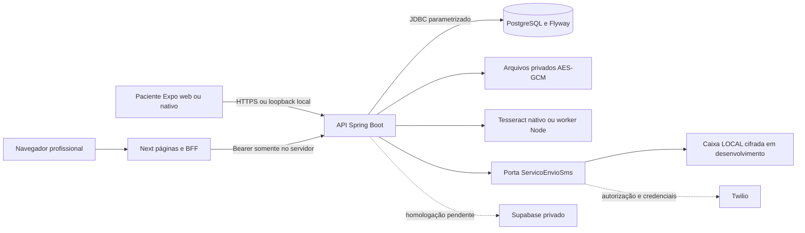
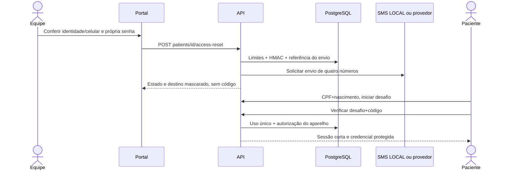

# Manual técnico completo do Viva+

Referência de transferência em 20/10/2026. Estado verificado no código, no PostgreSQL e nos testes; a publicação do fonte não libera uso produtivo. Leia este documento antes dos guias especializados. O [índice](INDICE_DOCUMENTACAO.md) reúne os materiais sem substituir os registros históricos.

## 1. Produto, pessoas e limites

Viva+ / Pulso em Dia é uma demonstração acadêmica de acompanhamento por equipe de saúde, especialmente para pessoas que registram pressão arterial e sua rotina de cuidado. O paciente usa React Native/Expo; profissional e administrador usam Next.js. As duas interfaces consultam a mesma API Java e o mesmo PostgreSQL. Nenhuma informação exibida como persistida depende de um array demonstrativo no frontend.

Existem duas modalidades: `APP`, com conta/aparelho do paciente, e `BRACELET_DIARY`, com transcrição profissional de diário e configuração de dispositivo explicitamente sem comunicação física validada. A modalidade de diário não exige smartphone. Um profissional cadastra e acompanha pacientes aos quais está vinculado; o administrador administra os vínculos da própria unidade. Unidade não é apenas filtro visual: o backend verifica organização e recurso.

O ciclo disponível é cadastro → regularização demográfica → ativação assistida → registros do paciente ou transcrição da equipe → consulta do histórico → registro de consulta/objetivos/plano. Medicamentos representam planos e autorrelatos, sem comprovação de ingestão. OCR sugere números de uma imagem, exige conferência e não mede pressão. Foto de refeição é armazenada; análise alimentar personalizada permanece indisponível sem provedor e critérios aprovados. Exercícios personalizados, vídeos e hardware real não foram concluídos.

Somente contas, registros e imagens sintéticos podem ser usados. `ConfiguracaoAmbiente` recusa `APP_ENV=production`, e o SQL tem restrições `demo_only`. Não retirar esses controles como atalho de implantação. Decisões clínicas, jurídicas e operacionais precisam de responsáveis institucionais. O [levantamento](LEVANTAMENTO_COMPLETO_PENDENCIAS.md) distingue cada pendência da funcionalidade local já validada.

## 2. Versões e responsabilidades tecnológicas

| Tecnologia | Versão verificada | Uso e fonte |
| --- | --- | --- |
| Node.js | 24.15.0 nesta máquina; engines `>=22.16.0 <25` | Ferramentas JS, Next e Expo; `package.json` |
| pnpm | 10.28.2 | Workspace e lock único; não usar npm install nem pnpm 11 para regravar o grafo |
| React / React DOM | 19.2.3 | UI de ambas as plataformas |
| React Native / web | 0.86.3 / 0.21.0 | Aplicativo nativo e renderização no navegador |
| Expo / Router | 57.0.21 / 57.0.28 | Configuração, navegação e exportação; app na raiz |
| Next.js | 16.4.2 | App Router, renderização no servidor e BFF; `web/package.json` |
| TypeScript | 5.9.3 | Tipagem dos clientes e contratos |
| TanStack Query | 5.90.5 | Estado de consultas em memória; não é cache clínico offline persistente |
| Java | 21; Microsoft OpenJDK 21.0.10 local | API única de negócio |
| Spring Boot | 3.5.16 | Web, validação, Security, JDBC, Actuator; `backend/demo/pom.xml` |
| Maven / Wrapper | 3.9.11 / 3.3.4 | Build reproduzível sem Maven global; SHA da distribuição fixado |
| PostgreSQL | 17.9 portátil nesta máquina | Banco `vivamais`, usuário `viva`, porta 55432; outra instalação 18/5432 não é este banco |
| Flyway / driver PG | 11.7.2 / 42.7.11 (JAR verificado) | Migrações SQL V1–V9; conferir versões efetivas com Maven dependency:tree |
| Spring Security | 6.5.11 (JAR verificado) | BCrypt profissional, filtro bearer opaco, autorização; não há JWT externo nem Firebase Auth |
| SecureStore / SQLite | Pacotes Expo 57 fixados no lock | Credencial do aparelho e fila SQLCipher nativos; validação física pendente |
| Tesseract.js | 7.0.0 | Alternativa Node para OCR real; Tesseract nativo no Docker |
| Java ImageIO / AES-GCM | JDK 21 | Decodificação, sanitização e cifra de objetos privados |
| Twilio REST | Adaptador próprio com Java HttpClient | Preparado, sem SDK, credenciais ou envio real nesta entrega |
| Supabase Storage | Adaptador HTTP no backend | Preparado; homologação externa pendente |
| JUnit / MockMvc / Testcontainers | BOM Spring | Unidades e integração com PostgreSQL real |
| Vitest / Playwright | 4.1.11 / 1.56.1 | Unidades/componentes e fluxos completos de navegador |

Lockfile e POM têm precedência sobre esta fotografia. `pnpm-workspace.yaml` contém overrides restritos e o patch `patches/query-string@7.1.3.patch`; preservá-los. Não presumir versões transitivas a partir de uma instalação global.

## 3. Arquitetura e fronteiras de confiança

O app chama `/api/v1` pelo transporte `services/transporteApi.ts`. Esse transporte recusa destino arbitrário/credencial na URL, controla timeout, não segue redirects e transforma falhas em mensagens públicas limitadas. `services/api.ts` resolve a base segundo o ambiente. Variáveis `EXPO_PUBLIC_*` são públicas no bundle e nunca podem conter segredos.

O portal mantém o bearer em cookie `viva_session` HttpOnly/Secure. `web/services/api.ts` lê o cookie somente no servidor, consulta a API e redireciona quando necessário. Componentes interativos passam pelo BFF `web/app/api/domain/[...path]/route.ts`; login/saída usam `api/session` e `api/logout`, fotos passam por `api/photos/[id]`. Não substituir essas rotas por token em localStorage. Origin, cookies e CSP devem ser mantidos. O portal usa classes CSS, sem style inline, devido à política estrita.

Na API, `ConfiguracaoSeguranca`, `FiltroTokenAcesso`, `FiltroLimiteRequisicao` e `ProtecaoAcessoPaciente` protegem o transporte; Controllers validam DTOs e chamam Services. `InstituicaoRepository` concentra consultas institucionais. Os Services de cuidado/arquivos/acesso também usam `JdbcTemplate` diretamente. **Não existem repositórios JPA por módulo**: não inventar uma camada `RegistroPressaoRepository` para explicar o código atual. Uma extração futura exige decisão técnica separada.

`SessaoAutenticada` representa a sessão resolvida. O token opaco fica somente no cliente autorizado e o banco guarda hash; profissional/admin tem sessão de 30 minutos. Para paciente, CPF+nascimento identificam o cadastro, mas não autenticam. Aparelho autorizado tem credencial criptográfica rotativa; no navegador, cookie protegido; no nativo, SecureStore. Sessão curta e autorização do aparelho são objetos diferentes.

Código tem quatro números, validade de dez minutos e uso único; limites ficam no banco. Falha de envio não deve derrubar aparelhos que já funcionavam. Troca real de telefone exige senha profissional/conferência, incrementa versão e revoga aparelhos/sessões/códigos. `telefone_confirmado_em` permanece nulo no modo LOCAL. Aceite do fornecedor não significa entrega; SMS não comprova identidade civil.

## 4. Estrutura e pontos de alteração

| Pasta/arquivo | Conteúdo e relação | Onde trabalhar |
| --- | --- | --- |
| `app/` | Expo Router, layouts e telas do paciente; rotas antigas redirecionam | Criar nova rota junto ao módulo; UI compartilhada em components |
| `components/` | Tela, barras, fotos, gráficos, formulários reutilizáveis | `Tela` separa ScrollView do rodapé; não colocar navegação entre botões |
| `contexts/` | Autenticação, preferências, contexto transitório de atividade | Estado comum e limpeza na mudança de titular; sem prescrição clínica |
| `hooks/` | Consultas/ações orientadas à tela, painel e roteiros | Reutilizar domínio services; tratar carregamento/erro/vazio |
| `services/` | Transporte, pressão, refeições, pacientes, lembretes e sincronização | Regra de cliente e adaptadores `.native.ts`; nunca segredo de backend |
| `assets/images/` | Recursos originais e imagens individuais fornecidas | Reutilizar originais sem recriar identidade; preservar proporções |
| `web/app/` | Login, páginas públicas, grupo `(portal)` e rotas BFF | Ler `web/AGENTS.md` e docs Next instaladas antes de alterar código |
| `web/components/` | Cadastro, ficha, dados pessoais, ativação, tabelas e preferências | Componentes cliente interagem com o BFF |
| `web/hooks/`, `web/services/` | Carregamento, API server-only e cálculos do portal | Não importar API server-only no bundle do navegador |
| `backend/demo/src/main/java/com/vivamais/` | Configuração, controller, dto, model, repositories, security, service | Autorização, transação e persistência ficam aqui |
| `backend/demo/src/main/resources/db/migration/` | SQL V1–V9 e histórico Flyway | Nova migração coordenada; nunca editar checksum aplicado |
| `backend/demo/src/test/` | JUnit e integrações PostgreSQL/MockMvc | Casos de autorização negativa, migração e persistência reais |
| `packages/contracts/` | OpenAPI, tipos gerados, acesso e validação cadastral | Backend → snapshot → geração; não editar generated.ts manualmente |
| `packages/design-tokens/` | Tokens de identidade visual | Mudanças comuns em acordo entre app e portal |
| `infra/` | Inicializadores, OCR worker, capturas e backup/restore | Scripts sem credenciais embutidas; artefatos em diretórios privados |
| `tests/mobile/`, `tests/e2e/` | Vitest app e Playwright integrado | Não confundir teste em navegador com ensaio físico |
| `docs/`, `referencias_codex/` | Requisitos, protótipos, evidências e transferência | Referências não são conteúdo clínico aprovado |

`.local`, `node_modules`, `target`, `dist` e o diretório de apoio `work` não fazem parte da entrega Git. Remanescentes antigos ignorados podem existir no computador; não são a arquitetura ativa. Não recriar `apps/mobile`, `apps/web`, `services/api` ou Git aninhado.

## 5. Dados, transações e arquivos

O [dicionário do banco](ARQUITETURA_BANCO_DADOS.md) descreve 33 tabelas do schema public, incluindo Flyway. Há 32 tabelas com RLS habilitada e **nenhuma política de acesso direto**. As migrações revogam privilégios PUBLIC/anon/authenticated quando aplicável. O usuário JDBC atual é proprietário e pode contornar RLS: o isolamento prático depende também das verificações obrigatórias da API, não de uma política mágica por tenant. Testar sempre outra clínica e outro paciente.

Registros têm identificador UUID, titular, autoria/origem e horário da ocorrência. Operações passíveis de repetição reutilizam o mesmo UUID para idempotência; não gerar UUID a cada retry. Datas de ocorrência são UTC no banco; apresentação e semana usam America/Sao_Paulo. Preferências e dados pessoais têm versão para detectar atualização concorrente; 409 exige recarregar/conferir, não sobrescrever silenciosamente.

`ArquivoPrivadoService` restringe tipo/tamanho/dimensões, decodifica e reencoda a imagem, remove metadados e usa `ArmazenamentoArquivos`. Arquivo local usa AES-GCM, metadados no PG e objeto fora de pasta pública. Downloads exigem autorização e concessão de curta duração. A chave de objetos e a chave HMAC do acesso precisam sobreviver a reinícios/restauração; perder chave não é corrigido gerando outra e declarando o backup recuperado.

OCR usa `ReconhecedorTesseract`/`ProvedorOcr`, com Tesseract instalado ou worker `infra/ocr-worker.mjs`. Reconhecimento grava um resultado para revisão; medição confirmada é outra ação explícita. `ProvedorAnaliseAlimentacaoHttp` só habilita análise com configuração e critérios/referência aprovados. Desligado ou indisponível deve resultar em estado verdadeiro, nunca classificação fictícia.

### Privilégio local observado na consolidação

Consulta somente de metadados confirmou que a role JDBC desta máquina também tem superusuário, BYPASSRLS, criação de roles e bancos. Trata-se do cluster sintético existente; não foi alterado para produzir documentação. Isso amplia o risco além de ser proprietária: **não reutilizar esse perfil na hospedagem**. P01/G01 passam a exigir separação entre migração/DDL e execução limitada, sem superusuário/BYPASSRLS no runtime, com testes de privilégios e regressão. O guia de clone cria role não superusuária; a configuração final de mínimo privilégio ainda precisa de implementação/homologação. RLS habilitada não protege contra essa credencial administrativa.

## 6. Ambiente, execução e diagnóstico

O [guia do zero](GUIA_COMPLETO_AMBIENTE_DESENVOLVIMENTO.md) separa máquina existente, clone novo e Docker. É obrigatório criar sua própria senha de bootstrap e banco: os arquivos privados do autor não estão no GitHub. Para a máquina existente, `Iniciar-VivaMais.cmd -Producao -SmsLocal` usa builds locais e caixa SMS cifrada, preservando o cluster17/55432. `-Producao` no script não muda o backend para APP_ENV production.

API8080, portal3000, app8081 e banco55432 são processos distintos. Health200 demonstra disponibilidade básica; testar login/escopo/persistência separadamente. Encerre pelo controlador/`infra/encerrar-local.ps1`; não use taskkill genérico, não remova postmaster.pid nem reinicialize cluster. O helper não provisiona um cluster novo ou recupera senhas de outra pessoa.

Para diagnosticar: conferir Java21 efetivamente selecionado, porta e JDBC; primeira exceção de Flyway/compilação, não apenas a última cascata; credencial profissional de bootstrap versus senha PostgreSQL; SMS LOCAL explicitamente habilitado; URL pública correta no build; cookie/Origin/proxy; arquivo/chave preservados. Consulte o manual de testes para falhas reproduzíveis. Não anexar logs brutos, headers, CPF, códigos ou imagens privadas a issues.

## 7. Testes e rastreabilidade

O [manual de testes](MANUAL_COMPLETO_TESTES_DESENVOLVEDOR.md) ensina instalação e execução por suíte. A entrega anterior de cadastro/SMS registrou 74 Java,69 frontend e17 E2E. A consolidação atual tem evidência própria no [relatório de publicação](RELATORIO_TRANSFERENCIA_E_PUBLICACAO.md): conferir ali execuções novas, falhas, comandos e auditoria, sem reutilizar número antigo como se fosse teste atual.

Exportar Hermes Android/iOS não cria APK/IPA e não ensaia câmera, notificações, SecureStore, SQLCipher ou acessibilidade de aparelhos. HTTP stub do Twilio não envia SMS. Restore V8 comprovado anteriormente não significa homologação de restore hospedado V9. Checklists manuais em branco não são resultados.

## 8. Operação econômica e próximos responsáveis

Mantém-se a arquitetura econômica registrada em [HOSPEDAGEM_DEMO](operations/HOSPEDAGEM_DEMO.md): Vercel para Next, Railway para Java, Supabase PostgreSQL/storage e EAS. Os preços desse documento têm data de referência e devem ser reconfirmados no momento da contratação. Esta tarefa publica somente fonte/documentação no GitHub; não cria contas, gasto, deployment, submissão a lojas ou autorização clínica.

O dev geral mantém autenticação/cadastro/portal/segurança transversal. Exercícios e IA têm [manuais próprios](MATRIZ_RESPONSABILIDADES_DESENVOLVIMENTO.md). Começar pelos bloqueios de segurança/ambiente e ensaios nativos, seguindo o [plano de continuidade](PLANO_TECNICO_CONTINUIDADE_DESENVOLVIMENTO.md). Não implementar protocolo, fornecedor ou arquitetura futura como se já estivessem aprovados.

Para uma nova funcionalidade: reproduzir requisito → verificar inventário/contratos → decidir schema/versão → backend com autorização e transação → contrato gerado → UI com serviços existentes → teste positivo/negativo/persistência → regressão → evidência sanitizada → atualizar progresso e revisão Git. O [guia de padrões](PADROES_DESENVOLVIMENTO_VIVAMAIS.md) dá exemplos concretos.
