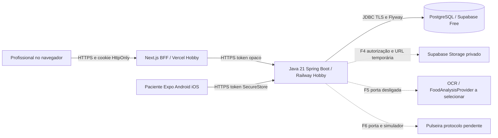

# ADR 001 Fundação do Viva+

Estado: aceito para a implementação técnica da demo sintética, 16/10/2026. Aprovações clínicas, jurídicas e de publicação continuam pendentes.

## Contexto e decisão

Monorepo pnpm. Organização atual após a padronização autorizada em 16–17/10: web/ (Next.js/TypeScript/Tailwind), aplicativo Expo na raiz em app/components/contexts/hooks/services/assets e backend/demo (Java 21/Spring Boot/Maven Wrapper), além de packages/contracts e packages/design-tokens. A estrutura anterior apps/web, apps/mobile e services/api foi substituída sem trocar a arquitetura. API REST versionada é a única autoridade do domínio; PostgreSQL com Flyway é a fonte persistente. Acesso profissional exige organização e vínculo explícito; papel administrador tem escopo da própria clínica. O paciente consulta sua própria identidade. Token opaco aleatório com validade e revogação permite encerrar sessões imediatamente. A API guarda somente seu hash.

Web encaminha requisições autenticadas pelo servidor Next e guarda token em cookie HttpOnly, SameSite e Secure em HTTPS. Ações mutáveis do BFF validam origem. Mobile fala HTTPS com a API e usa SecureStore; não salva credenciais em AsyncStorage. Health mínimo é público, documentação e recursos exigem autenticação. Login tem limitação de tentativas e respostas genéricas; logs não contêm corpo clínico, senha ou token. Instantes usam timestamptz/UTC; horários de medicamentos terão timezone explícito.

## Componentes e fluxo de dados

Credenciais de banco/storage pertencem ao backend. Clientes recebem somente respostas autorizadas. Fotos não são públicas. Arquivos privados e OCR Tesseract já têm implementação/testes reais; o adaptador Supabase ainda precisa de ensaio no fornecedor. Análise alimentar externa permanece indisponível sem serviço e critérios aprovados. Não há treinamento de modelos com fotos dos pacientes.

## Modelo de dados

Núcleo: Organization → UserAccount (role), Professional, Patient e PatientProfessionalAssignment. Sessions vinculam usuário, hash e validade. AuditEvent registra ação, ator, organização, recurso e horário sem corpo clínico. ConsentOrLegalBasisRecord não presume consentimento como única base.

Expansão mantida no plano: BloodPressureReading (medido/inserido/sincronizado/origem/autor), MedicationPlan → MedicationSchedule → MedicationSelfReport; FileObject → MealPhoto → MealEducationalAssessment; PhysicalActivityProfile → ActivityRecord; Consultation; PrintedDiaryEntry; Device → DeviceConfiguration; SyncOperation e ApprovedEducationalContent. UUIDs, constraints e índices; CPF opcional normalizado só será coletado após necessidade justificada e visibilidade autorizada. Não coletar endereço/CPF por conveniência na fundação.

Tabelas de fases posteriores podem ser criadas por migrações posteriores; a presença no modelo não significa recurso implementado. Escolha JPA ou JDBC por simplicidade de cada módulo, com SQL parametrizado e transações. Testes de integração usam PostgreSQL real, nunca H2 como evidência de migração PostgreSQL.

## Implantação e alternativas

Local: Docker Compose PostgreSQL e API; web/mobile via pnpm. Demo: Vercel Hobby + Railway Hobby + Supabase Free + EAS Free. Sites/Cloudflare Workers não substitui o backend Java solicitado. Se pausa do banco inviabilizar revisão, considerar Neon e R2 com aprovação e sem mudar o contrato. Não criar recursos de fornecedores nesta iteração.

## Atualização de 17/10 — dados pessoais na demonstração

O pedido explícito de cadastro completo foi implementado por V6 aditiva: CPF, nascimento, telefone, contato, sexo e endereço opcionais, exclusivamente fictícios na demonstração. Dados antigos permanecem válidos. CPF tem validação estrutural/dígitos e unicidade por clínica, não prova identidade nem autentica. GET/PUT pessoais exigem o mesmo escopo por recurso; paciente altera somente telefone, profissional vinculado pode editar cadastro. Versão impede sobrescrever edição concorrente e o e-mail de contato não modifica a credencial de login. RLS/revogações da tabela patient permanecem. Coleta real e base legal continuam dependendo da revisão institucional.

## Decisão de 20/10 — acesso do paciente sem senha

CPF/nascimento agora identificam no aplicativo; não são autenticadores suficientes. V8 mantém credenciais de aparelhos aleatórias de 256 bits/hash no banco, código presencial de quatro números/HMAC e limites persistidos. Web usa cookie HttpOnly/Secure/SameSite/Origin; nativo SecureStore. Sessão curta continua revogável e vinculada ao aparelho. Profissional/admin seguem com BCrypt. Não alterar V1–V8, criar tabelas públicas ou expor código/chave. Detalhes e transição segura em ../ACESSO_PACIENTE_SEM_SENHA.md. Nenhuma regra clínica/IA ou nova hospedagem foi adicionada.

## Decisão V9 — ativação por SMS e telefone autenticador

Porta ServicoEnvioSms desacopla autenticação do fornecedor. API profissional retorna só metadados, nunca código. LOCAL usa caixa cifrada privada em development/test explicitamente habilitado; Twilio exige autorização/configuração e distingue aceite de entrega. A tentativa ambígua invalida o código, sem retry automático. Novos pacientes exigem celular E.164; legado é preservado e regularizado antes de envio. Troca do número exige reautenticação/conferência profissional e revoga acesso. V9 adiciona metadados/RLS e amplia telefone sem reescrever dados; V1–V9 imutáveis. Consulta oficial de CPF e uso real dependem de instituição/serviços. Ver ../CADASTRO_E_ATIVACAO_SMS.md e ../LEVANTAMENTO_COMPLETO_PENDENCIAS.md.
