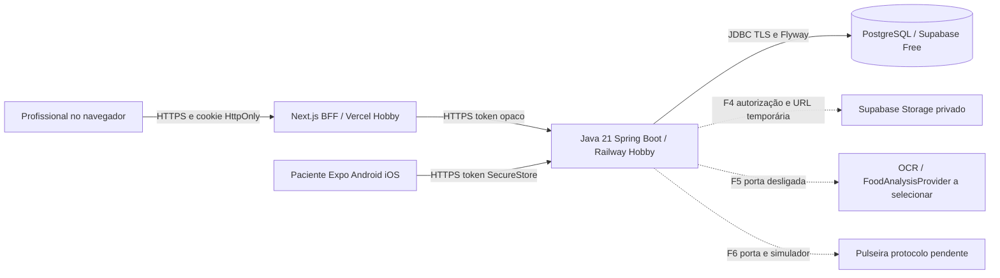

# ADR 001 Fundação do Viva+

Estado: aceito para a implementação técnica da demo sintética, 16/10/2026. Aprovações clínicas, jurídicas e de publicação continuam pendentes.

## Contexto e decisão

Monorepo pnpm com apps/web (Next.js/TypeScript/Tailwind), apps/mobile (Expo/React Native/TypeScript/Expo Router), services/api (Java 21/Spring Boot/Maven Wrapper), packages/contracts e packages/design-tokens. API REST versionada é a única autoridade do domínio; PostgreSQL com Flyway é a fonte persistente. Acesso profissional exige organização e vínculo explícito; papel administrador tem escopo da própria clínica. O paciente consulta sua própria identidade. JWT não é necessário na fundação: token opaco aleatório com validade e revogação evita uma chave de assinatura distribuída e permite encerrar sessões imediatamente. A API guarda somente seu hash.

Web encaminha requisições autenticadas pelo servidor Next e guarda token em cookie HttpOnly, SameSite e Secure em HTTPS. Ações mutáveis do BFF validam origem. Mobile fala HTTPS com a API e usa SecureStore; não salva credenciais em AsyncStorage. Health mínimo é público, documentação e recursos exigem autenticação. Login tem limitação de tentativas e respostas genéricas; logs não contêm corpo clínico, senha ou token. Instantes usam timestamptz/UTC; horários de medicamentos terão timezone explícito.

## Componentes e fluxo de dados

Credenciais de banco/storage pertencem ao backend. Clientes recebem somente respostas autorizadas. Fotos não são públicas. Analítica identificável e treinamento de modelos com imagens de saúde não são habilitados. Arquivos e IA são portas futuras, sem integração fictícia nesta entrega.

## Modelo de dados

Núcleo: Organization → UserAccount (role), Professional, Patient e PatientProfessionalAssignment. Sessions vinculam usuário, hash e validade. AuditEvent registra ação, ator, organização, recurso e horário sem corpo clínico. ConsentOrLegalBasisRecord não presume consentimento como única base.

Expansão mantida no plano: BloodPressureReading (medido/inserido/sincronizado/origem/autor), MedicationPlan → MedicationSchedule → MedicationSelfReport; FileObject → MealPhoto → MealEducationalAssessment; PhysicalActivityProfile → ActivityRecord; Consultation; PrintedDiaryEntry; Device → DeviceConfiguration; SyncOperation e ApprovedEducationalContent. UUIDs, constraints e índices; CPF opcional normalizado só será coletado após necessidade justificada e visibilidade autorizada. Não coletar endereço/CPF por conveniência na fundação.

Tabelas de fases posteriores podem ser criadas por migrações posteriores; a presença no modelo não significa recurso implementado. Escolha JPA ou JDBC por simplicidade de cada módulo, com SQL parametrizado e transações. Testes de integração usam PostgreSQL real, nunca H2 como evidência de migração PostgreSQL.

## Implantação e alternativas

Local: Docker Compose PostgreSQL e API; web/mobile via pnpm. Demo: Vercel Hobby + Railway Hobby + Supabase Free + EAS Free. Sites/Cloudflare Workers não substitui o backend Java solicitado. Se pausa do banco inviabilizar revisão, considerar Neon e R2 com aprovação e sem mudar o contrato. Não criar recursos de fornecedores nesta iteração.
