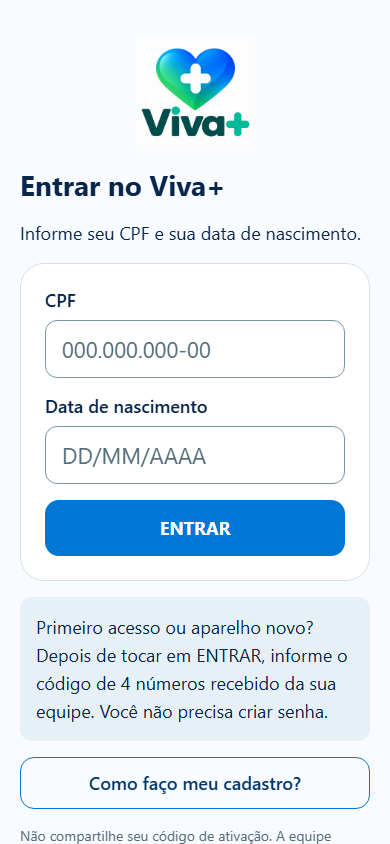
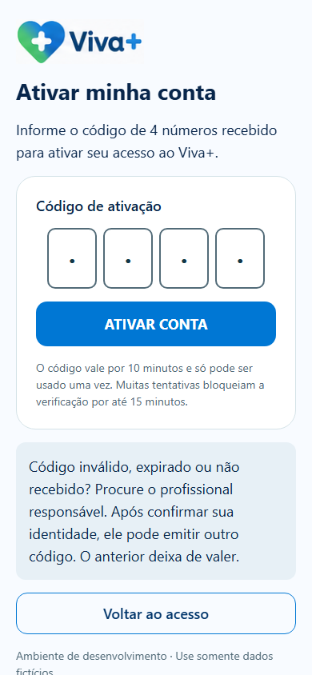

# Acesso do paciente sem senha — entrega local validada

Pedido: [arquivo integral](../product/PEDIDO_ACESSO_PACIENTE_2026-10-20.md). Não reiniciar o projeto. Nenhum commit/push/publicação autorizado. Exercícios e IA permanecem delegados.

## Implementação atual

- V8 aditiva cria dispositivo_acesso_paciente, codigo_ativacao_paciente, desafio_acesso_paciente e limite_acesso_paciente, com RLS/revogação direta; auth_session ganha vínculo ao aparelho. Invalida códigos longos/sessões antigas de pacientes, sem apagar usuários, senhas ou registros. Não modifica sessões profissionais nem V1–V7.
- AcessoPacienteService/Controller: iniciar com CPF/nascimento; verificar desafio opaco + quatro números; renovar com credencial criptográfica; esquecer aparelho autenticado. Identidades inexistentes, nascimento divergente e CPF ambíguo entre unidades recebem a mesma resposta de verificação, sem dados de saúde. Ambiguidade falha de modo fechado e exige coordenação cadastral, sem unir contas.
- Código CSPRNG de 0000 a 9999, uso único, dez minutos. Hash HMAC-SHA256 com chave privada separada em .patient-auth-key ou PATIENT_AUTH_HMAC_KEY. Banco sozinho não permite enumerar códigos offline. Nenhum código em log/auditoria.
- Verificação: cinco tentativas por identidade/15 minutos, inclusive novos desafios, e trinta por IP/15 minutos. Emissão: confirmação presencial declarada + senha atual + organização/vínculo; uma por minuto, três/hora, dez/dia por paciente e quarenta/hora por profissional. Reemissão revoga dispositivos/sessões e invalida código anterior. Janelas persistidas não são revertidas em erro HTTP nem reinício.
- Aparelho usa token aleatório de 256 bits, hash no banco, expiração absoluta de trinta dias, rotação ao entrar/renovar, sessão curta de trinta minutos vinculada ao aparelho. Não é atestado de hardware: é prova de posse da credencial protegida instalada naquele cliente. Logout desabilita renovação automática; mantém autorização para novo acesso com CPF/nascimento. Esquecer ou recuperação profissional revogam aparelho/sessões. Mudança profissional de CPF/nascimento também revoga acesso.
- Navegador: cookie host-only, HttpOnly/Secure/SameSite Strict/path específico, nunca localStorage; Origin exato obrigatório. API nega canal nativo quando Origin/Sec-Fetch indicam navegador e não entrega a credencial web no JSON. Dados clínicos continuam exigindo Bearer. Nativo: SecureStore WHEN_UNLOCKED_THIS_DEVICE_ONLY, ensaio físico pendente. WEB precisa cookies aceitos e implantação HTTPS no mesmo site ou proxy apropriado; não enfraquecer cookie para contornar bloqueio de terceiros.
- Cadastro APP exige CPF/nascimento; e-mail é contato opcional e pode ser compartilhado por dois pacientes. Novas contas usam identificador interno independente desse contato; contas anteriores não são reescritas. Cadastro antigo sem CPF/nascimento precisa complementação autorizada antes da ativação. Senhas antigas de pacientes não autenticam em /auth/login; profissionais/admin continuam pelo método anterior.
- Portal apresenta emissão/estado, esconde código quando expirado/entregue/inativo e consulta estado sem recuperar o segredo. App tem máscaras, teclado numérico e quatro espaços acessíveis; não pede senha.

## Testes efetivamente executados nesta alteração

| Verificação                    | Resultado final                                                                                                                                                                                                                                                 |
| ------------------------------ | --------------------------------------------------------------------------------------------------------------------------------------------------------------------------------------------------------------------------------------------------------------- |
| Maven verify/Java 21           | **48 aprovados**: 8 unitários + 40 integrações PostgreSQL (17 de acesso, 13 de cuidado, 10 da fundação); sem falhas/erros/skips                                                                                                                                 |
| Frontend app                   | **30 aprovados**, incluindo máscaras/calendário/transporte e proteção da credencial no SecureStore; teste de contrato, sem simular aparelho físico                                                                                                              |
| Frontend portal                | **28 aprovados**, incluindo emissão assistida, erro de emissão e estado sem código recuperável                                                                                                                                                                  |
| E2E completo final             | **14 aprovados em 1,2 minuto**, com cadastro/ativação, Home, módulos, pressão, autorrelatos, fila, OCR real, fotos, perfil, períodos, consultas, preferências e permissões                                                                                      |
| Novo percurso de aparelho      | Ativação, cookie Secure/HttpOnly/SameSite Strict, recarga, logout persistido, novo login no aparelho autorizado, aparelho desconhecido e desautorização aprovados                                                                                               |
| Tipagem/qualidade              | TypeScript app/web/contratos/tokens e ESLint aprovados; sintaxe Node/PowerShell dos scripts conferida                                                                                                                                                           |
| Builds                         | Next/Webpack aprovado; Expo web/Android/iOS exportados com Hermes; web final em dist                                                                                                                                                                            |
| Atualização do banco existente | [V8 aplicada](acesso-paciente/migracao-v8.json): 32 tabelas/31 RLS; 11 contagens clínicas/cadastrais, objetos/chave e fontes/checksums V1–V7 preservados antes dos novos ensaios                                                                                |
| Backup/restauração V8          | [Aprovado em banco isolado](acesso-paciente/backup-restauracao-v8.json): 62 objetos no snapshot, duas chaves, AES-GCM/autenticidade/adulteração, login profissional, isolamento e foto antiga. Credenciais de pacientes revogadas no clone; original preservado |

São resultados desta alteração, não os antigos 31/40/13 da entrega anterior. Após a última mudança funcional de contato, Maven e o E2E completo foram repetidos. O alinhamento final do formulário profissional foi recompilado e recapturado.

[Conferência final de integridade](acesso-paciente/validacao-final.json): arquivos, referências locais, capturas, contratos, dados sensíveis conhecidos e estado do Git. Essa conferência não substitui os testes funcionais acima.

Logs privados em ../../work, relativo à raiz: auth-paciente-java-contato-final.log, auth-paciente-e2e-final.log, auth-paciente-next-final.log, auth-paciente-expo-all.log, auth-paciente-expo-web.log e auth-paciente-backup-v8.log. Não publicar esses diretórios nem copiar credenciais para documentos.

Falhas intermediárias resolvidas: permissão de rede da sandbox para PostgreSQL; processo do banco encerrado com o término do comando, corrigido mantendo controlador ativo; mock frontend reutilizando Response consumida; filtro HTTP do Playwright omitindo cookie Secure do loopback, corrigido inspecionando atributos sem remover a exigência de segurança. Nenhuma dessas tentativas com falha foi contada como aprovação.

## Cobertura dos vinte casos solicitados

| Caso                      | Evidência                                                                                         |
| ------------------------- | ------------------------------------------------------------------------------------------------- |
| 1. CPF/nascimento         | AcessoPacienteIT + E2E acesso-paciente                                                            |
| 2. CPF inválido           | API 400 e validação visual antes de enviar                                                        |
| 3. Nascimento incorreto   | Resposta genérica de verificação, sem sessão; código não permite acesso a identidade divergente   |
| 4. Quatro dígitos         | Emissão real e validação de formato; não é senha permanente                                       |
| 5. Zeros iniciais         | Fixture isolada 0007 verificada como string; máscaras preservam zeros                             |
| 6. Expirado               | API recusa e não autoriza aparelho                                                                |
| 7. Utilizado              | Mesmo desafio e outro desafio não reutilizam o código                                             |
| 8. Incorreto              | API recusa sem revelar conta                                                                      |
| 9. Excesso                | Cinco verificações por identidade, mesmo trocando desafio                                         |
| 10. Bloqueio temporário   | 429 persistido; janela expirada permite nova verificação com código válido                        |
| 11. Reemissão             | Cooldown, novo valor diferente e código anterior recusado                                         |
| 12. Autorizado            | CPF/nascimento e credencial abrem sessão; E2E sem novo código após logout                         |
| 13. Desconhecido          | Não recebe sessão somente com dados pessoais; outro contexto do navegador exige verificação       |
| 14. Sessão                | Renovação/rotação, token antigo inválido, expiração do aparelho, logout e esquecer                |
| 15. Isolamento            | Paciente não acessa outro; organização/vínculo preservados nos testes de API e E2E                |
| 16. Cadastro profissional | Formulário real → PostgreSQL → confirmação/reauth → código → ativação                             |
| 17. Profissionais         | Login, dashboard, permissões e saída pelo método anterior; senha de paciente recusada             |
| 18. Dados existentes      | Teste V7→V8 e conferência do banco principal; hashes profissionais/registros preservados          |
| 19. Home                  | E2E após ativação e após novo acesso/recarga                                                      |
| 20. Módulos               | Regressões reais de pressão, medicamentos, alimentação, histórico, perfil e consultas preservadas |

## Telas atualizadas

[Manifesto das sete capturas](acesso-paciente/capturas.json). Sem senhas, CPF/nascimento preenchidos ou códigos ativos; magenta indica máscara da captura, não aparência do campo. As evidências antigas foram preservadas.

Outras telas: [cadastro profissional](acesso-paciente/cadastro_profissional.png), [emissão assistida](acesso-paciente/emissao_profissional.png), [estado ativado sem código](acesso-paciente/estado_ativado_portal.png), [Home](acesso-paciente/inicio_paciente.png) e [configurações/revogação](acesso-paciente/configuracoes_paciente.png). As sete cenas não apresentaram rolagem horizontal na verificação de viewport. Capturas do paciente em 390 px e do portal em 1280 px; não é certificação WCAG.

## Arquivos principais alterados

- Backend: novos AcessoPacienteService, AcessoPacienteController, ProtecaoAcessoPaciente e ModelosAcessoPaciente; V8; integração em CuidadoService/Controller, AutenticacaoService, InstituicaoRepository, DadosPessoaisService, ConfiguracaoSeguranca/OpenApi e application.yml.
- App: acesso, ativar-conta, cadastro, configurações e cabeçalho do perfil; ContextoAutenticacao; novo services/autenticacao/dispositivoPaciente; transporte com cookie restrito às rotas de autorização.
- Portal: AtivacaoPaciente e seus testes, CadastroPaciente/CamposDadosPessoais, integração na ficha CuidadoPaciente, CSS e allowlist access-status no BFF.
- Contratos: OpenAPI regenerado, generated.ts e helpers de acesso em packages/contracts; cópias compartilhadas sincronizadas.
- Verificação: AcessoPacienteIT/ApoioAcessoPaciente, regressões Java adaptadas, cinco testes de proteção nativa, dez de entrada/transporte, teste visual do portal e E2E adaptados sem retirar verificações dos módulos. Capturas/backup atualizados.
- Documentação: AGENTS, README, PROGRESSO, STATUS, PROXIMA_EXECUCAO, COMO_NAVEGAR, guias/inventário/checklist, manual geral e notas de integração nos manuais delegados; .env.example sem valor de segredo.

## Como testar e pendências

[Guia completo de acesso e migração](../ACESSO_PACIENTE_SEM_SENHA.md). Portal http://127.0.0.1:3000, app http://127.0.0.1:8081/acesso. O profissional cadastra pessoa fictícia, confere identidade e confirma sua própria senha para gerar código. No app: CPF/nascimento → ENTRAR → quatro números → ATIVAR CONTA → Home. Contas antigas devem ter CPF/nascimento complementados pela equipe, sem apagar registros. Não há senha do paciente nem envio SMS/e-mail configurado.

Pendem aparelhos físicos/leitores de tela, APK/IPA/assinatura/lojas, política institucional de identidade/retenção e implantação HTTPS/proxy para navegador distribuído. CPF/nascimento ambíguos entre unidades falham de modo fechado; contexto de instituição é evolução a definir antes desse uso. Chave HMAC deve ser estável/compartilhada entre réplicas; não rotacioná-la para contornar limites.

Dois alertas altos gerais continuam registrados, sem mudança de dependências nesta alteração; [análise de segurança](../DEPENDENCIAS_SEGURANCA.md). Produção continua bloqueada. Export nativo, testes locais e esta revisão não constituem aprovação clínica/institucional nem ensaio físico. Nenhum novo desenvolvimento de exercícios/IA, commit, push ou publicação.

Referências técnicas consultadas: [OWASP recuperação](https://cheatsheetseries.owasp.org/cheatsheets/Forgot_Password_Cheat_Sheet.html) e [sessões](https://cheatsheetseries.owasp.org/cheatsheets/Session_Management_Cheat_Sheet.html). Código de quatro dígitos tem baixa entropia; esses controles não equivalem a certificação de segurança ou autorização de uso clínico real.
