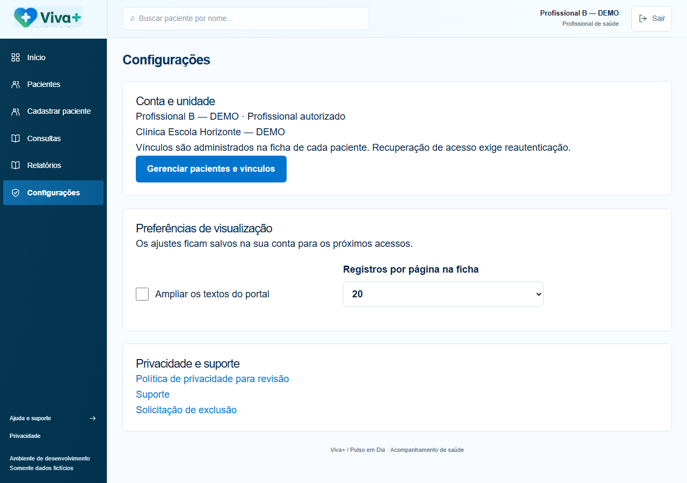
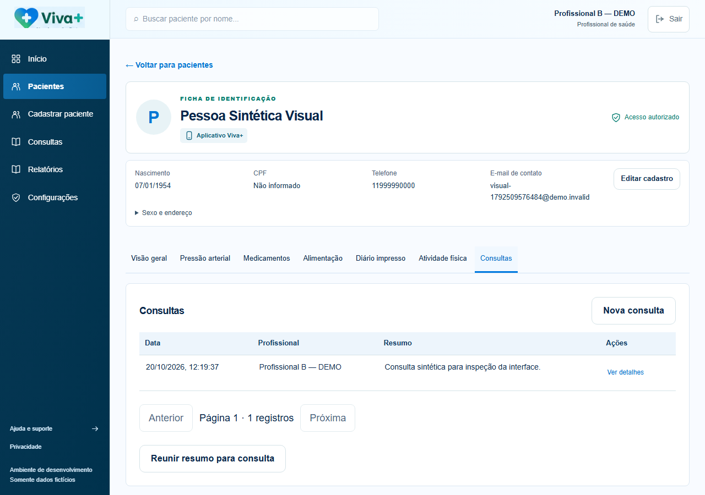

# Viva+ — fechamento da retomada e transferência — 20/10/2026

Etapa encerrada com ambiente local funcional, documentação específica e evidências atualizadas. Não significa liberação para produção. [Pedido integral](../product/PEDIDO_TRANSFERENCIA_DEV_2026-10-20.md).

## Onde a execução havia parado

A profissionalização já havia implementado preferências PostgreSQL/versionamento, textos, autoria, totais completos, correções de dependências moderadas, CSP e proteção de ambiente. Faltavam a inspeção/capturas finais, consolidação documental e relatório. Código e Git foram examinados; nada foi reiniciado ou descartado. O relato intermediário de 12 E2E foi superado por uma rodada completa de 13 aprovados, registrada no log anterior.

Ao retomar, os processos antigos não estavam mais ativos. O registro de execução foi conferido, encerrado/arquivado pelo helper e o cluster existente reiniciado pelo próprio pg_ctl, sem apagar PID/cluster ou criar banco principal. O atalho foi exercitado novamente; depois houve encerramento com checkpoint e reinício para recompilar apenas o portal.

## O que já estava concluído e foi preservado

| Evidência anterior, conferida nos arquivos/logs | Resultado herdado, sem nova execução integral                                                                                  |
| ----------------------------------------------- | ------------------------------------------------------------------------------------------------------------------------------ |
| Java 21/Maven verify                            | 31 testes: 8 unitários+23 integrações PostgreSQL; zero falhas/erros/skips; OCR real                                            |
| Frontend                                        | 40 testes: 15 app+25 web aprovados                                                                                             |
| E2E completo                                    | 13 aprovados juntos, 1, 2 min; cadastro/ativação/Home/módulos/perfil/consulta/autorizações/fila/OCR/foto/períodos/preferências |
| Next/Expo                                       | Build Next aprovado; exports web/Android/iOS com Hermes aprovados; sem APK/IPA ou ensaio físico                                |
| Backup/restauração                              | V1–V7 em banco isolado; 28 tabelas/27 RLS, snapshot de 52 objetos, login/403/foto, cifra/adulteração e original preservados    |
| Dependências                                    | Dois moderados corrigidos por overrides pontuais/patch CJS–ESM; dois altos mantidos                                            |
| Recursos                                        | 52 PNG fornecidos/cópias app/portal idênticos, sem reamostragem                                                                |

Logs privados: work/java-profissionalizacao-entrega.log; test-app-profissionalizacao.log; test-web-profissionalizacao-csp.log; e2e-profissionalizacao-verificado.log; expo-profissionalizacao.log; backup-profissionalizacao-final.log. Não copiar logs/segredos privados para o repositório.

## Finalizado nesta retomada

- Leitura integral do novo pedido e revisão dos caminhos/classes/DTOs/SQL reais para transferência.
- Capturas concluídas e comparadas; evidências antigas em visual/testes-manuais preservadas. O conjunto desta revisão foi atualizado após correções do próprio lote.
- Checkbox de texto ampliado alinhado ao formulário; paginação com espaçamento/alinhamento próprios, preservando as abas e a CSP.
- Perfil Expo preview, já utilizado em eas.json, novamente aceito pela validação de ambiente sem perder a exigência de HTTPS público. Dois testes específicos passaram.
- Quatro manuais entregues: [exercícios](../TRANSFERENCIA_DEV_EXERCICIOS.md), [IA](../TRANSFERENCIA_DEV_INTELIGENCIA_ARTIFICIAL.md), [continuidade geral](../MANUAL_CONTINUIDADE_DESENVOLVIMENTO.md) e [responsabilidades](../MATRIZ_RESPONSABILIDADES_DESENVOLVIMENTO.md).
- Documentados estados implementado/parcial/pendente/aprovação, arquivos, tabelas, contratos, payloads, variáveis sem credenciais, testes, prioridades e critérios de aceite.
- Exercícios e IA não receberam novas funcionalidades específicas. O OCR Tesseract/registro voluntário existentes e seus testes permanecem. Não houve novo provedor, prompt, vídeo, prescrição ou protocolo.

## Validações realmente executadas nesta retomada

| Verificação                      | Resultado novo                                                                                                                  |
| -------------------------------- | ------------------------------------------------------------------------------------------------------------------------------- |
| Inicialização pelo CMD e saúde   | PostgreSQL existente, API 8080/Next 3000/app 8081; HTTP 200 e health UP                                                         |
| Regressão dirigida após reinício | 5 E2E aprovados, 9, 9 s: páginas públicas/proteção/CSRF/login profissional e persistência entre sessões                         |
| Após ajuste final do portal      | 1 E2E de preferências aprovado, 5, 9 s, incluindo novo acesso no portal e dois contextos do app                                 |
| Unitários pertinentes            | 2 configuração Expo e 2 preferências do portal aprovados                                                                        |
| Next                             | Novo build/Webpack aprovado após ajustes; TypeScript executado pelo build                                                       |
| Capturas                         | 52 cenas+35 pares/3 painéis, e 2 cenas adicionais do portal 390 px                                                              |
| Checagem estrutural              | Nas 52 cenas: 0 controles sem nome/0 imagens sem alternativa pela heurística/0 imagens quebradas/0 rolagem horizontal da página |
| Portal 390 px                    | Configurações com texto ampliado e ficha de consultas aprovadas; tabelas podem rolar dentro do próprio contêiner                |
| Auditoria JS repetida            | 0 críticos/2 altos/0 moderados, 922 dependências, exit 1 preservado; sem suppression/upgrade forçado                            |
| Integridade documental/Git       | Quatro manuais com links locais conferidos; stage vazio; nenhum commit/push/reset/clean/publicação                              |

A checagem de nomes/imagens é heurística, não certificação WCAG nem ensaio com leitor de tela/idosos. Não foram repetidas todas as suítes Java/Expo sem mudança que justificasse; resultados anteriores estão identificados como herdados. Nenhum ensaio nativo foi declarado a partir de export.

## Evidências visuais

[Manifesto das 52 capturas](profissionalizacao/capturas.json), [diferenças por tela](profissionalizacao/COMPARACAO_VISUAL.md), [portal 390 px](profissionalizacao/responsividade.json). Três painéis revistos: [paciente](profissionalizacao/comparacoes/painel_app.png), [portal](profissionalizacao/comparacoes/painel_web.png), [atividade preservada](profissionalizacao/comparacoes/painel_atividade.png). Configurações/consultas também foram abertas em tamanho real.

As cores de indicadores/gráfico/foto agora são aplicadas por CSS compatível com CSP; não se abriu unsafe-inline. Permanecem diferenças de fonte/escala/composição, avatar, logo horizontal legado e estados que dependem de conteúdo/serviço/hardware. O próprio bitmap horizontal legado contém um fragmento inferior; ajuste visual geral ainda registrado. CPF isolado foi substituído por autenticação segura. Sem semáforo clínico/ingestão/atividade inventados para copiar o protótipo. Campos magenta são máscaras de privacidade da captura. Não há aceite de 36 telas idênticas ou captura de notificação nativa.

## Arquivos desta retomada

- Novos: os quatro manuais obrigatórios; este relatório; docs/product/PEDIDO_TRANSFERENCIA_DEV_2026-10-20.md; infra/verificar-portal-estreito.mjs; evidências em profissionalizacao.
- Ajustes gerais: app.config.ts (compatibilidade preview), web/components/PreferenciasPortal.tsx (classe de alinhamento), web/app/globals.css (formulário/paginação).
- Consolidação: README, AGENTS, PROGRESSO, STATUS, PROXIMA_EXECUCAO, FIDELIDADE_VISUAL, DEPENDENCIAS_SEGURANCA, guias/inventário/checklist e relatório da profissionalização. Nenhuma nova migração após V7.

As centenas de alterações locais anteriores não foram atribuídas a esta retomada. Não houve .git criado em subpastas, stage, commit, push ou alteração remota.

## Pendências separadas

**Geral:** dois altos de dependências; CI/OWASP/secret scanner; refino visual e logo legado; ensaios físicos/câmera/notificações/proteção nativa/leitores; revisão institucional/jurídica/canais/direitos/retenção/modelo produtivo e credenciais/publicação. Nomes em alguns detalhes de dispositivo continuam indisponíveis; consultas/diários e demais tabelas documentadas já resolvem autoria.

**Exercícios — outro dev:** catálogo/conteúdo versionados, passos/vídeos aprovados, avaliação/prescrição/regras clínicas, concorrência do perfil, agenda semanal e hardware somente se especificado. Histórico/semana de realizados e registro voluntário funcionam; não são plano prescrito. [Prioridades e aceite](../TRANSFERENCIA_DEV_EXERCICIOS.md).

**IA — outro dev:** fornecedor/escopo aprovados, validação estrita de respostas, versão/cache/histórico, qualidade/tempos OCR e ensaio externo. Tesseract real funciona com confirmação; análise alimentar está indisponível sem configuração/aprovação. [Prioridades e aceite](../TRANSFERENCIA_DEV_INTELIGENCIA_ARTIFICIAL.md).

## Próximo passo e acesso

Entregar [o manual geral](../MANUAL_CONTINUIDADE_DESENVOLVIMENTO.md) e a matriz ao responsável seguinte, acordar arquivos compartilhados e a numeração da próxima migração antes de alterar exercícios/IA. Não há estimativa de prazo comprometida.

Portal local: http://127.0.0.1:3000. App: http://127.0.0.1:8081. Inicializar após reiniciar a máquina/encerrar esta sessão com Iniciar-VivaMais.cmd. Hospedagem econômica preservada, sem custo/deploy. Produção continua bloqueada por pendências reais, independentemente dos testes locais aprovados.

## Conferência final de integridade

TypeScript do app, portal, contratos e tokens aprovado. ESLint dos arquivos de código alterados nesta retomada e `node --check infra/verificar-portal-estreito.mjs` aprovados. `git diff --check` passou; stage vazio e nenhuma pasta Git aninhada encontrada nas fontes.

Busca das duas senhas locais conhecidas nos arquivos textuais entregáveis: nenhuma ocorrência. Essa busca não substitui o scanner completo de segredos pendente em CI. Links locais e caminhos completos de fontes dos quatro manuais, deste relatório e da comparação foram conferidos, sem destinos ausentes. Os dados das verificações estão em [validacao-final.json](profissionalizacao/validacao-final.json).

Consulta somente de leitura ao PostgreSQL atual confirmou sete migrações aplicadas até V7, 28 tabelas em public e 27 protegidas por RLS. Nova verificação pelo helper confirmou HTTP 200 na API/portal/app e health UP. Nenhuma suíte integral foi repetida para essa conferência documental.
